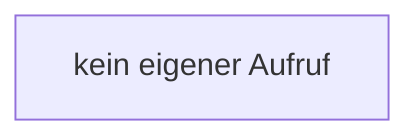

[[00 Start]] › [[Host-Betrieb]] › [[Host-Ersteinrichtung]] › [[HostFirstSetup]] › [[HostFirstSetup.Teil1]] › [[HostFirstSetup.HostFirstSetup]]

# HostFirstSetup.HostFirstSetup

`HostFirstSetup.HostFirstSetup()` [src/main/java/de/aichele/childlauncher/HostFirstSetup.java:29–29](https://github.com/Sciddie/minecraft-serverhoster-plugin/blob/95b02b953b0b4c23673e900e021a7c3c844aa37d/src/main/java/de/aichele/childlauncher/HostFirstSetup.java#L29-L29)



```knoten
kein eigener Aufruf
  In diesem Stück gibt es keinen weiteren eigenen Aufruf.
```

> [!knoten]- Was die Blöcke tun
> - **kein eigener Aufruf**: In diesem Stück gibt es keinen weiteren eigenen Aufruf.

- Die [[Glossar#Ersteinrichtung|Ersteinrichtung]] kümmert sich um die erste die [[Glossar#Einrichtung|Einrichtung]].
- `HostFirstSetup` in `src/main/java/de/aichele/childlauncher/HostFirstSetup.java`
