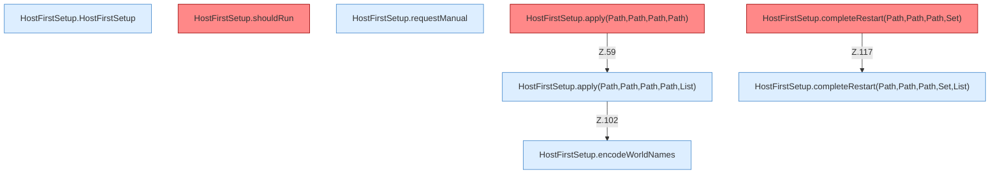

[[00 Start]] › [[Host-Betrieb]] › [[Host-Ersteinrichtung]] › [[HostFirstSetup]] › [[HostFirstSetup.Teil1]]

# HostFirstSetup.Teil1



```knoten
HostFirstSetup.HostFirstSetup
  Betrifft den Host `HostFirstSetup`.
HostFirstSetup.shouldRun
  Entscheidet, ob `shouldRun`. Ruft `readState`, `writeMarker`. Befund: Altlast (wahrscheinlich).
HostFirstSetup.requestManual
  Fordert an `requestManual`. Ruft `readState`, `writeMarker`.
HostFirstSetup.apply(Path,Path,Path,Path)
  Wendet an `apply`. Ruft `apply`. Befund: toter Code (wahrscheinlich).
HostFirstSetup.apply(Path,Path,Path,Path,List)
  Wendet an `apply`. Ruft `readState`, `requireRoot`, `otherPluginJars`.
HostFirstSetup.completeRestart(Path,Path,Path,Set)
  Schließt ab `completeRestart`. Ruft `completeRestart`. Befund: toter Code (wahrscheinlich).
HostFirstSetup.completeRestart(Path,Path,Path,Set,List)
  Schließt ab `completeRestart`. Ruft `readState`, `requireRoot`, `lobbyNameSafe`.
HostFirstSetup.encodeWorldNames
  Kodiert `encodeWorldNames`.
```


