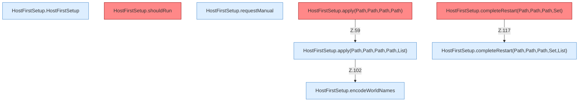

[[00 Start]] › [[Host-Betrieb]] › [[Host-Ersteinrichtung]] › [[HostFirstSetup]] › [[HostFirstSetup.Teil1]]

# HostFirstSetup.Teil1



```knoten
HostFirstSetup.HostFirstSetup
  Die [[Glossar#Ersteinrichtung|Ersteinrichtung]] kümmert sich um die erste die [[Glossar#Einrichtung|Einrichtung]]. Betrifft den [[Glossar#Host|Host]] `HostFirstSetup`.
HostFirstSetup.shouldRun
  Die [[Glossar#Ersteinrichtung|Ersteinrichtung]] führt aus das. Entscheidet, ob `shouldRun`. Ruft `readState`, `writeMarker`. [[Glossar#Befund|Befund]]: [[Glossar#Altlast|Altlast]], wahrscheinlich. HostFirstSetup.java:35 akzeptiert pending; Schreibstelle nur HostMinimizeTest.java:216
HostFirstSetup.requestManual
  Die [[Glossar#Ersteinrichtung|Ersteinrichtung]] fordert an die Handarbeit. Fordert an `requestManual`. Ruft `readState`, `writeMarker`.
HostFirstSetup.apply(Path,Path,Path,Path)
  Die [[Glossar#Ersteinrichtung|Ersteinrichtung]] wendet an das. Wendet an `apply`. Ruft `apply`. [[Glossar#Befund|Befund]]: toter Code, wahrscheinlich. src/main/java/de/aichele/childlauncher/HostFirstSetup.java:58–60 nur von Tests erreicht
HostFirstSetup.apply(Path,Path,Path,Path,List)
  Die [[Glossar#Ersteinrichtung|Ersteinrichtung]] wendet an das. Wendet an `apply`. Ruft `readState`, `requireRoot`, `otherPluginJars`.
HostFirstSetup.completeRestart(Path,Path,Path,Set)
  Die [[Glossar#Ersteinrichtung|Ersteinrichtung]] kümmert sich um den [[Glossar#Neustart|Neustart]]. Schließt ab `completeRestart`. Ruft `completeRestart`. [[Glossar#Befund|Befund]]: toter Code, wahrscheinlich. src/main/java/de/aichele/childlauncher/HostFirstSetup.java:116–118 nur von Tests erreicht
HostFirstSetup.completeRestart(Path,Path,Path,Set,List)
  Die [[Glossar#Ersteinrichtung|Ersteinrichtung]] kümmert sich um den [[Glossar#Neustart|Neustart]]. Schließt ab `completeRestart`. Ruft `readState`, `requireRoot`, `lobbyNameSafe`.
HostFirstSetup.encodeWorldNames
  Die [[Glossar#Ersteinrichtung|Ersteinrichtung]] kümmert sich um die [[Glossar#Spielwelt|Spielwelt]] die Namen. Kodiert `encodeWorldNames`.
```

> [!knoten]- Was die Blöcke tun
> - **HostFirstSetup.HostFirstSetup**: Die [[Glossar#Ersteinrichtung|Ersteinrichtung]] kümmert sich um die erste die [[Glossar#Einrichtung|Einrichtung]]. Betrifft den [[Glossar#Host|Host]] `HostFirstSetup`.
> - **HostFirstSetup.shouldRun**: Die [[Glossar#Ersteinrichtung|Ersteinrichtung]] führt aus das. Entscheidet, ob `shouldRun`. Ruft `readState`, `writeMarker`. [[Glossar#Befund|Befund]]: [[Glossar#Altlast|Altlast]], wahrscheinlich. HostFirstSetup.java:35 akzeptiert pending; Schreibstelle nur HostMinimizeTest.java:216
> - **HostFirstSetup.requestManual**: Die [[Glossar#Ersteinrichtung|Ersteinrichtung]] fordert an die Handarbeit. Fordert an `requestManual`. Ruft `readState`, `writeMarker`.
> - **HostFirstSetup.apply(Path,Path,Path,Path)**: Die [[Glossar#Ersteinrichtung|Ersteinrichtung]] wendet an das. Wendet an `apply`. Ruft `apply`. [[Glossar#Befund|Befund]]: toter Code, wahrscheinlich. src/main/java/de/aichele/childlauncher/HostFirstSetup.java:58–60 nur von Tests erreicht
> - **HostFirstSetup.apply(Path,Path,Path,Path,List)**: Die [[Glossar#Ersteinrichtung|Ersteinrichtung]] wendet an das. Wendet an `apply`. Ruft `readState`, `requireRoot`, `otherPluginJars`.
> - **HostFirstSetup.completeRestart(Path,Path,Path,Set)**: Die [[Glossar#Ersteinrichtung|Ersteinrichtung]] kümmert sich um den [[Glossar#Neustart|Neustart]]. Schließt ab `completeRestart`. Ruft `completeRestart`. [[Glossar#Befund|Befund]]: toter Code, wahrscheinlich. src/main/java/de/aichele/childlauncher/HostFirstSetup.java:116–118 nur von Tests erreicht
> - **HostFirstSetup.completeRestart(Path,Path,Path,Set,List)**: Die [[Glossar#Ersteinrichtung|Ersteinrichtung]] kümmert sich um den [[Glossar#Neustart|Neustart]]. Schließt ab `completeRestart`. Ruft `readState`, `requireRoot`, `lobbyNameSafe`.
> - **HostFirstSetup.encodeWorldNames**: Die [[Glossar#Ersteinrichtung|Ersteinrichtung]] kümmert sich um die [[Glossar#Spielwelt|Spielwelt]] die Namen. Kodiert `encodeWorldNames`.

- Ein weiterer Abschnitt derselben Übersicht.
