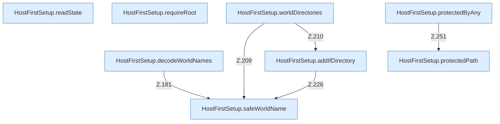

[[00 Start]] › [[Host-Betrieb]] › [[Host-Ersteinrichtung]] › [[HostFirstSetup]] › [[HostFirstSetup.Teil2]]

# HostFirstSetup.Teil2



```knoten
HostFirstSetup.decodeWorldNames
  Die [[Glossar#Ersteinrichtung|Ersteinrichtung]] kümmert sich um die [[Glossar#Spielwelt|Spielwelt]] die Namen. Dekodiert `decodeWorldNames`. Ruft `safeWorldName`.
HostFirstSetup.readState
  Die [[Glossar#Ersteinrichtung|Ersteinrichtung]] liest den Zustand. Liest `readState`. Ruft `readState`.
HostFirstSetup.requireRoot
  Die [[Glossar#Ersteinrichtung|Ersteinrichtung]] kümmert sich um den Anfang. Verlangt `requireRoot`.
HostFirstSetup.worldDirectories
  Die [[Glossar#Ersteinrichtung|Ersteinrichtung]] macht hier einen einzelnen Schritt. Eine Ebene tiefer steht er genauer. Betrifft die Welt `worldDirectories`. Ruft `safeWorldName`, `addIfDirectory`.
HostFirstSetup.addIfDirectory
  Die [[Glossar#Ersteinrichtung|Ersteinrichtung]] fügt hinzu hier einen Schritt. Eine Ebene tiefer steht er genauer. Fügt hinzu `addIfDirectory`. Ruft `safeWorldName`.
HostFirstSetup.safeWorldName
  Die [[Glossar#Ersteinrichtung|Ersteinrichtung]] kümmert sich um die [[Glossar#Spielwelt|Spielwelt]] den Namen. Prüft die Pfadgrenze `safeWorldName`.
HostFirstSetup.protectedPath
  Die [[Glossar#Ersteinrichtung|Ersteinrichtung]] kümmert sich um den Pfad. `protectedPath` in `HostFirstSetup.java`.
HostFirstSetup.protectedByAny
  Die [[Glossar#Ersteinrichtung|Ersteinrichtung]] macht hier einen einzelnen Schritt. Eine Ebene tiefer steht er genauer. `protectedByAny` in `HostFirstSetup.java`. Ruft `protectedPath`.
```

> [!knoten]- Was die Blöcke tun
> - **HostFirstSetup.decodeWorldNames**: Die [[Glossar#Ersteinrichtung|Ersteinrichtung]] kümmert sich um die [[Glossar#Spielwelt|Spielwelt]] die Namen. Dekodiert `decodeWorldNames`. Ruft `safeWorldName`.
> - **HostFirstSetup.readState**: Die [[Glossar#Ersteinrichtung|Ersteinrichtung]] liest den Zustand. Liest `readState`. Ruft `readState`.
> - **HostFirstSetup.requireRoot**: Die [[Glossar#Ersteinrichtung|Ersteinrichtung]] kümmert sich um den Anfang. Verlangt `requireRoot`.
> - **HostFirstSetup.worldDirectories**: Die [[Glossar#Ersteinrichtung|Ersteinrichtung]] macht hier einen einzelnen Schritt. Eine Ebene tiefer steht er genauer. Betrifft die Welt `worldDirectories`. Ruft `safeWorldName`, `addIfDirectory`.
> - **HostFirstSetup.addIfDirectory**: Die [[Glossar#Ersteinrichtung|Ersteinrichtung]] fügt hinzu hier einen Schritt. Eine Ebene tiefer steht er genauer. Fügt hinzu `addIfDirectory`. Ruft `safeWorldName`.
> - **HostFirstSetup.safeWorldName**: Die [[Glossar#Ersteinrichtung|Ersteinrichtung]] kümmert sich um die [[Glossar#Spielwelt|Spielwelt]] den Namen. Prüft die Pfadgrenze `safeWorldName`.
> - **HostFirstSetup.protectedPath**: Die [[Glossar#Ersteinrichtung|Ersteinrichtung]] kümmert sich um den Pfad. `protectedPath` in `HostFirstSetup.java`.
> - **HostFirstSetup.protectedByAny**: Die [[Glossar#Ersteinrichtung|Ersteinrichtung]] macht hier einen einzelnen Schritt. Eine Ebene tiefer steht er genauer. `protectedByAny` in `HostFirstSetup.java`. Ruft `protectedPath`.

- Ein weiterer Abschnitt derselben Übersicht.
