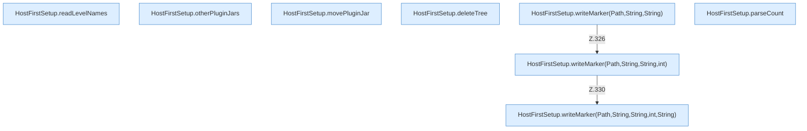

[[00 Start]] › [[Host-Betrieb]] › [[Host-Ersteinrichtung]] › [[HostFirstSetup]] › [[HostFirstSetup.Teil3]]

# HostFirstSetup.Teil3



```knoten
HostFirstSetup.readLevelNames
  Die [[Glossar#Ersteinrichtung|Ersteinrichtung]] liest die Namen. Liest `readLevelNames`. Ruft `safeWorldName`.
HostFirstSetup.otherPluginJars
  Die [[Glossar#Ersteinrichtung|Ersteinrichtung]] macht hier einen einzelnen Schritt. Eine Ebene tiefer steht er genauer. `otherPluginJars` in `HostFirstSetup.java`.
HostFirstSetup.movePluginJar
  Die [[Glossar#Ersteinrichtung|Ersteinrichtung]] kümmert sich um das [[Glossar#Plugin|Plugin]] die [[Glossar#Programmdatei|Programmdatei]]. Verschiebt `movePluginJar`.
HostFirstSetup.deleteTree
  Die [[Glossar#Ersteinrichtung|Ersteinrichtung]] löscht hier einen Schritt. Eine Ebene tiefer steht er genauer. Löscht `deleteTree`. Ruft `visitFile`, `postVisitDirectory`.
HostFirstSetup.writeMarker(Path,String,String)
  Die [[Glossar#Ersteinrichtung|Ersteinrichtung]] schreibt die Merkdatei. Schreibt `writeMarker`. Ruft `writeMarker`.
HostFirstSetup.writeMarker(Path,String,String,int)
  Die [[Glossar#Ersteinrichtung|Ersteinrichtung]] schreibt die Merkdatei. Schreibt `writeMarker`. Ruft `writeMarker`.
HostFirstSetup.writeMarker(Path,String,String,int,String)
  Die [[Glossar#Ersteinrichtung|Ersteinrichtung]] schreibt die Merkdatei. Schreibt `writeMarker`.
HostFirstSetup.parseCount
  Die [[Glossar#Ersteinrichtung|Ersteinrichtung]] liest hier einen Schritt. Eine Ebene tiefer steht er genauer. Wertet aus `parseCount`.
```

> [!knoten]- Was die Blöcke tun
> - **HostFirstSetup.readLevelNames**: Die [[Glossar#Ersteinrichtung|Ersteinrichtung]] liest die Namen. Liest `readLevelNames`. Ruft `safeWorldName`.
> - **HostFirstSetup.otherPluginJars**: Die [[Glossar#Ersteinrichtung|Ersteinrichtung]] macht hier einen einzelnen Schritt. Eine Ebene tiefer steht er genauer. `otherPluginJars` in `HostFirstSetup.java`.
> - **HostFirstSetup.movePluginJar**: Die [[Glossar#Ersteinrichtung|Ersteinrichtung]] kümmert sich um das [[Glossar#Plugin|Plugin]] die [[Glossar#Programmdatei|Programmdatei]]. Verschiebt `movePluginJar`.
> - **HostFirstSetup.deleteTree**: Die [[Glossar#Ersteinrichtung|Ersteinrichtung]] löscht hier einen Schritt. Eine Ebene tiefer steht er genauer. Löscht `deleteTree`. Ruft `visitFile`, `postVisitDirectory`.
> - **HostFirstSetup.writeMarker(Path,String,String)**: Die [[Glossar#Ersteinrichtung|Ersteinrichtung]] schreibt die Merkdatei. Schreibt `writeMarker`. Ruft `writeMarker`.
> - **HostFirstSetup.writeMarker(Path,String,String,int)**: Die [[Glossar#Ersteinrichtung|Ersteinrichtung]] schreibt die Merkdatei. Schreibt `writeMarker`. Ruft `writeMarker`.
> - **HostFirstSetup.writeMarker(Path,String,String,int,String)**: Die [[Glossar#Ersteinrichtung|Ersteinrichtung]] schreibt die Merkdatei. Schreibt `writeMarker`.
> - **HostFirstSetup.parseCount**: Die [[Glossar#Ersteinrichtung|Ersteinrichtung]] liest hier einen Schritt. Eine Ebene tiefer steht er genauer. Wertet aus `parseCount`.

- Ein weiterer Abschnitt derselben Übersicht.
