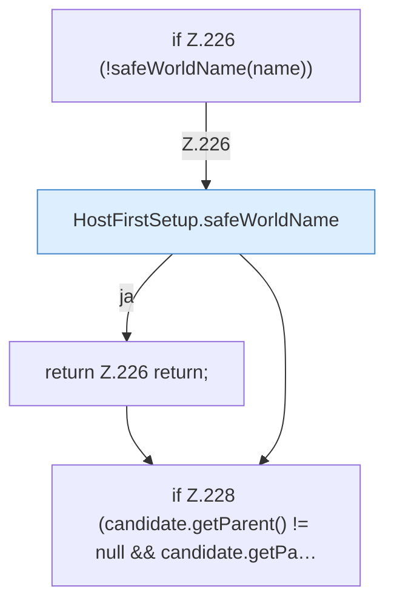

[[00 Start]] › [[Host-Betrieb]] › [[Host-Ersteinrichtung]] › [[HostFirstSetup]] › [[HostFirstSetup.Teil2]] › [[HostFirstSetup.addIfDirectory]]

# HostFirstSetup.addIfDirectory

`HostFirstSetup.addIfDirectory(Path root, String name, Set<Path> worlds)` [src/main/java/de/aichele/childlauncher/HostFirstSetup.java:225–230](https://github.com/Sciddie/minecraft-serverhoster-plugin/blob/95b02b953b0b4c23673e900e021a7c3c844aa37d/src/main/java/de/aichele/childlauncher/HostFirstSetup.java#L225-L230)



```knoten
if Z.226 (!safeWorldName(name))
  Zeile 226: prüft `(!safeWorldName(name))`.
HostFirstSetup.safeWorldName
  Die [[Glossar#Ersteinrichtung|Ersteinrichtung]] kümmert sich um die [[Glossar#Spielwelt|Spielwelt]] den Namen. Prüft die Pfadgrenze `safeWorldName`.
return Z.226 return;
  Zeile 226: Rückgabe `return;`.
if Z.228 (candidate.getParent() != null && candidate.getPa…
  Zeile 228: prüft `(candidate.getParent() != null && candidate.getPa…`.
```

> [!knoten]- Was die Blöcke tun
> - **if Z.226 (!safeWorldName(name))**: Zeile 226: prüft `(!safeWorldName(name))`.
> - **HostFirstSetup.safeWorldName**: Die [[Glossar#Ersteinrichtung|Ersteinrichtung]] kümmert sich um die [[Glossar#Spielwelt|Spielwelt]] den Namen. Prüft die Pfadgrenze `safeWorldName`.
> - **return Z.226 return;**: Zeile 226: Rückgabe `return;`.
> - **if Z.228 (candidate.getParent() != null && candidate.getPa…**: Zeile 228: prüft `(candidate.getParent() != null && candidate.getPa…`.

- Die [[Glossar#Ersteinrichtung|Ersteinrichtung]] fügt hinzu hier einen Schritt. Eine Ebene tiefer steht er genauer.
- `addIfDirectory` in `src/main/java/de/aichele/childlauncher/HostFirstSetup.java`
