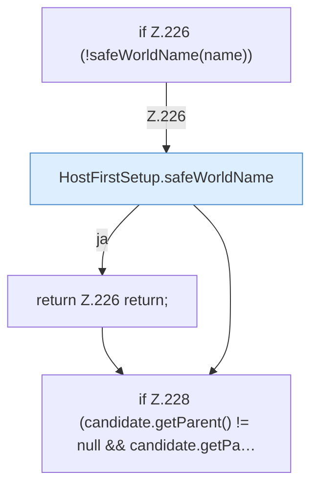

[[00 Start]] › [[Host-Betrieb]] › [[Host-Ersteinrichtung]] › [[HostFirstSetup]] › [[HostFirstSetup.Teil2]] › [[HostFirstSetup.addIfDirectory]]

# HostFirstSetup.addIfDirectory

`HostFirstSetup.addIfDirectory(Path root, String name, Set<Path> worlds)` [src/main/java/de/aichele/childlauncher/HostFirstSetup.java:225–230](https://github.com/Sciddie/minecraft-serverhoster-plugin/blob/95b02b953b0b4c23673e900e021a7c3c844aa37d/src/main/java/de/aichele/childlauncher/HostFirstSetup.java#L225-L230)

- `addIfDirectory` in `src/main/java/de/aichele/childlauncher/HostFirstSetup.java`
