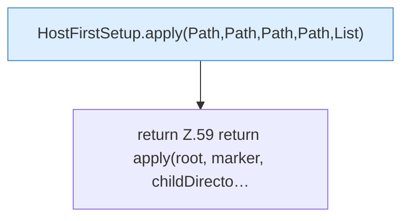

[[00 Start]] › [[Host-Betrieb]] › [[Host-Ersteinrichtung]] › [[HostFirstSetup]] › [[HostFirstSetup.Teil1]] › [[HostFirstSetup.apply(Path,Path,Path,Path)]]

# HostFirstSetup.apply(Path,Path,Path,Path)

`HostFirstSetup.apply(Path root, Path marker, Path childDirectory, Path runningPluginJar)` [src/main/java/de/aichele/childlauncher/HostFirstSetup.java:58–60](https://github.com/Sciddie/minecraft-serverhoster-plugin/blob/95b02b953b0b4c23673e900e021a7c3c844aa37d/src/main/java/de/aichele/childlauncher/HostFirstSetup.java#L58-L60)



```knoten
HostFirstSetup.apply(Path,Path,Path,Path,List)
  Die [[Glossar#Ersteinrichtung|Ersteinrichtung]] wendet an das. Wendet an `apply`. Ruft `readState`, `requireRoot`, `otherPluginJars`.
return Z.59 return apply(root, marker, childDirecto…
  Zeile 59: Rückgabe `return apply(root, marker, childDirecto…`.
```

> [!knoten]- Was die Blöcke tun
> - **HostFirstSetup.apply(Path,Path,Path,Path,List)**: Die [[Glossar#Ersteinrichtung|Ersteinrichtung]] wendet an das. Wendet an `apply`. Ruft `readState`, `requireRoot`, `otherPluginJars`.
> - **return Z.59 return apply(root, marker, childDirecto…**: Zeile 59: Rückgabe `return apply(root, marker, childDirecto…`.

- Die [[Glossar#Ersteinrichtung|Ersteinrichtung]] wendet an das.
- `apply` in `src/main/java/de/aichele/childlauncher/HostFirstSetup.java`
- Befund: toter Code, wahrscheinlich. src/main/java/de/aichele/childlauncher/HostFirstSetup.java:58–60 nur von Tests erreicht
