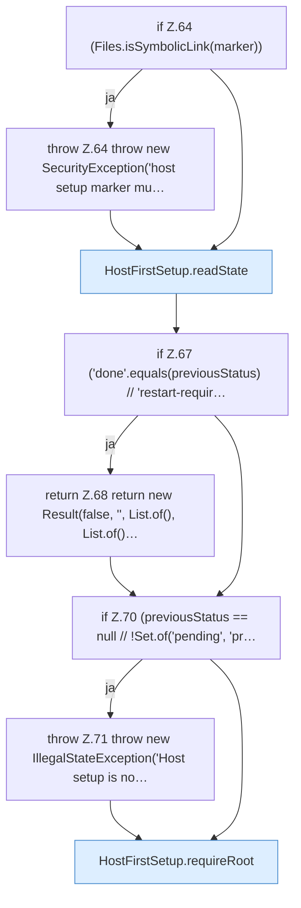

[[00 Start]] › [[Host-Betrieb]] › [[Host-Ersteinrichtung]] › [[HostFirstSetup]] › [[HostFirstSetup.Teil1]] › [[HostFirstSetup.apply(Path,Path,Path,Path,List)]] › [[HostFirstSetup.apply(Path,Path,Path,Path,List).Teil1]]

# HostFirstSetup.apply(Path,Path,Path,Path,List).Teil1



```knoten
if Z.64 (Files.isSymbolicLink(marker))
  Zeile 64: prüft `(Files.isSymbolicLink(marker))`.
throw Z.64 throw new SecurityException('host setup marker mu…
  Zeile 64: Abbruch `throw new SecurityException('host setup marker mu…`.
HostFirstSetup.readState
  Liest `readState`. Ruft `readState`.
if Z.67 ('done'.equals(previousStatus) // 'restart-requir…
  Zeile 67: prüft `('done'.equals(previousStatus) // 'restart-requir…`.
return Z.68 return new Result(false, '', List.of(), List.of()…
  Zeile 68: Rückgabe `return new Result(false, '', List.of(), List.of()…`.
if Z.70 (previousStatus == null // !Set.of('pending', 'pr…
  Zeile 70: prüft `(previousStatus == null // !Set.of('pending', 'pr…`.
throw Z.71 throw new IllegalStateException('Host setup is no…
  Zeile 71: Abbruch `throw new IllegalStateException('Host setup is no…`.
HostFirstSetup.requireRoot
  Verlangt `requireRoot`.
```

- Fortsetzung von `HostFirstSetup.apply(Path,Path,Path,Path,List)`, Quellreihenfolge.
