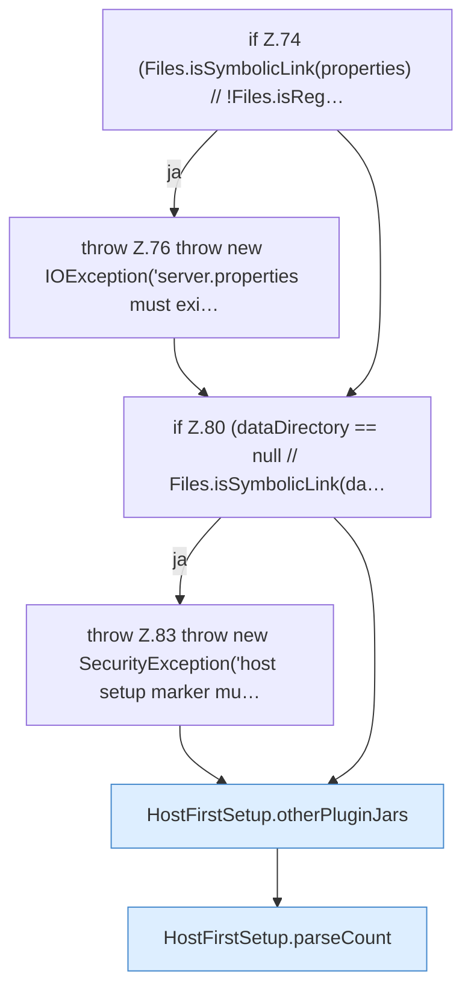

[[00 Start]] › [[Host-Betrieb]] › [[Host-Ersteinrichtung]] › [[HostFirstSetup]] › [[HostFirstSetup.Teil1]] › [[HostFirstSetup.apply(Path,Path,Path,Path,List)]] › [[HostFirstSetup.apply(Path,Path,Path,Path,List).Teil2]]

# HostFirstSetup.apply(Path,Path,Path,Path,List).Teil2



```knoten
if Z.74 (Files.isSymbolicLink(properties) // !Files.isReg…
  Zeile 74: prüft `(Files.isSymbolicLink(properties) // !Files.isReg…`.
throw Z.76 throw new IOException('server.properties must exi…
  Zeile 76: Abbruch `throw new IOException('server.properties must exi…`.
if Z.80 (dataDirectory == null // Files.isSymbolicLink(da…
  Zeile 80: prüft `(dataDirectory == null // Files.isSymbolicLink(da…`.
throw Z.83 throw new SecurityException('host setup marker mu…
  Zeile 83: Abbruch `throw new SecurityException('host setup marker mu…`.
HostFirstSetup.otherPluginJars
  `otherPluginJars` in `HostFirstSetup.java`.
HostFirstSetup.parseCount
  Wertet aus `parseCount`.
```

- Fortsetzung von `HostFirstSetup.apply(Path,Path,Path,Path,List)`, Quellreihenfolge.
