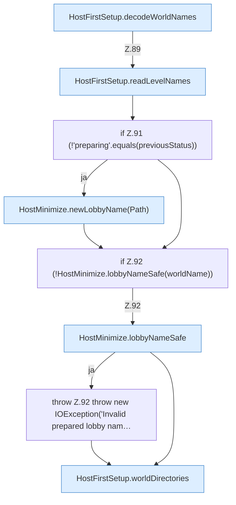

[[00 Start]] › [[Host-Betrieb]] › [[Host-Ersteinrichtung]] › [[HostFirstSetup]] › [[HostFirstSetup.Teil1]] › [[HostFirstSetup.apply(Path,Path,Path,Path,List)]] › [[HostFirstSetup.apply(Path,Path,Path,Path,List).Teil3]]

# HostFirstSetup.apply(Path,Path,Path,Path,List).Teil3

- Fortsetzung von `HostFirstSetup.apply(Path,Path,Path,Path,List)`, Quellreihenfolge.
