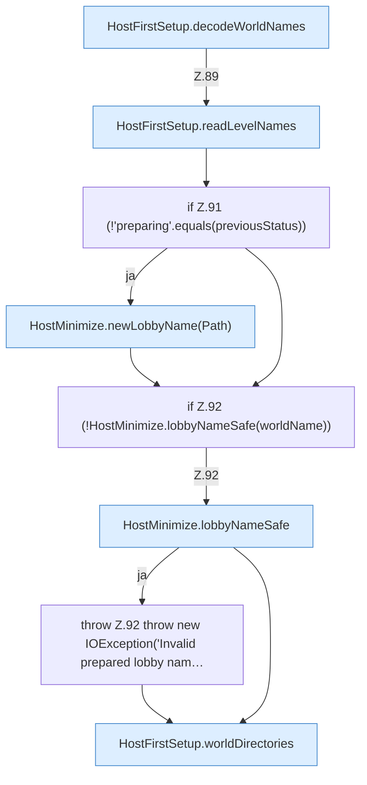

[[00 Start]] › [[Host-Betrieb]] › [[Host-Ersteinrichtung]] › [[HostFirstSetup]] › [[HostFirstSetup.Teil1]] › [[HostFirstSetup.apply(Path,Path,Path,Path,List)]] › [[HostFirstSetup.apply(Path,Path,Path,Path,List).Teil3]]

# HostFirstSetup.apply(Path,Path,Path,Path,List).Teil3



```knoten
HostFirstSetup.decodeWorldNames
  Die [[Glossar#Ersteinrichtung|Ersteinrichtung]] kümmert sich um die [[Glossar#Spielwelt|Spielwelt]] die Namen. Dekodiert `decodeWorldNames`. Ruft `safeWorldName`.
HostFirstSetup.readLevelNames
  Die [[Glossar#Ersteinrichtung|Ersteinrichtung]] liest die Namen. Liest `readLevelNames`. Ruft `safeWorldName`.
if Z.91 (!'preparing'.equals(previousStatus))
  Zeile 91: prüft `(!'preparing'.equals(previousStatus))`.
HostMinimize.newLobbyName(Path)
  Das Verkleinern des [[Glossar#Host|Host]] kümmert sich um die Wartewelt den Namen. `newLobbyName` in `HostMinimize.java`. Ruft `newLobbyName`.
if Z.92 (!HostMinimize.lobbyNameSafe(worldName))
  Zeile 92: prüft `(!HostMinimize.lobbyNameSafe(worldName))`.
HostMinimize.lobbyNameSafe
  Das Verkleinern des [[Glossar#Host|Host]] kümmert sich um den Namen die erlaubte Grenze. `lobbyNameSafe` in `HostMinimize.java`.
throw Z.92 throw new IOException('Invalid prepared lobby nam…
  Zeile 92: Abbruch `throw new IOException('Invalid prepared lobby nam…`.
HostFirstSetup.worldDirectories
  Die [[Glossar#Ersteinrichtung|Ersteinrichtung]] macht hier einen einzelnen Schritt. Eine Ebene tiefer steht er genauer. Betrifft die Welt `worldDirectories`. Ruft `safeWorldName`, `addIfDirectory`.
```

> [!knoten]- Was die Blöcke tun
> - **HostFirstSetup.decodeWorldNames**: Die [[Glossar#Ersteinrichtung|Ersteinrichtung]] kümmert sich um die [[Glossar#Spielwelt|Spielwelt]] die Namen. Dekodiert `decodeWorldNames`. Ruft `safeWorldName`.
> - **HostFirstSetup.readLevelNames**: Die [[Glossar#Ersteinrichtung|Ersteinrichtung]] liest die Namen. Liest `readLevelNames`. Ruft `safeWorldName`.
> - **if Z.91 (!'preparing'.equals(previousStatus))**: Zeile 91: prüft `(!'preparing'.equals(previousStatus))`.
> - **HostMinimize.newLobbyName(Path)**: Das Verkleinern des [[Glossar#Host|Host]] kümmert sich um die Wartewelt den Namen. `newLobbyName` in `HostMinimize.java`. Ruft `newLobbyName`.
> - **if Z.92 (!HostMinimize.lobbyNameSafe(worldName))**: Zeile 92: prüft `(!HostMinimize.lobbyNameSafe(worldName))`.
> - **HostMinimize.lobbyNameSafe**: Das Verkleinern des [[Glossar#Host|Host]] kümmert sich um den Namen die erlaubte Grenze. `lobbyNameSafe` in `HostMinimize.java`.
> - **throw Z.92 throw new IOException('Invalid prepared lobby nam…**: Zeile 92: Abbruch `throw new IOException('Invalid prepared lobby nam…`.
> - **HostFirstSetup.worldDirectories**: Die [[Glossar#Ersteinrichtung|Ersteinrichtung]] macht hier einen einzelnen Schritt. Eine Ebene tiefer steht er genauer. Betrifft die Welt `worldDirectories`. Ruft `safeWorldName`, `addIfDirectory`.

- Ein weiterer Abschnitt derselben Übersicht.
- Fortsetzung von `HostFirstSetup.apply(Path,Path,Path,Path,List)`.
