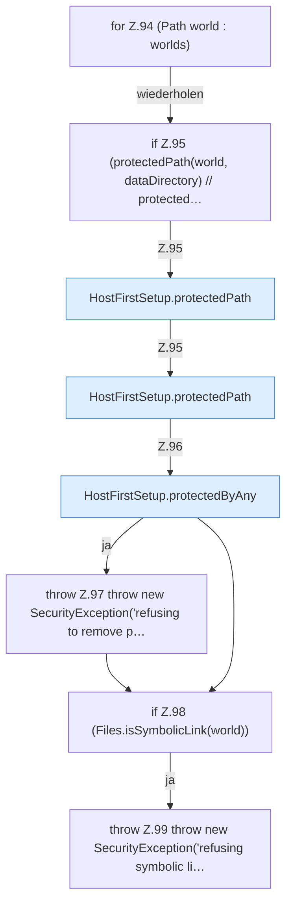

[[00 Start]] › [[Host-Betrieb]] › [[Host-Ersteinrichtung]] › [[HostFirstSetup]] › [[HostFirstSetup.Teil1]] › [[HostFirstSetup.apply(Path,Path,Path,Path,List)]] › [[HostFirstSetup.apply(Path,Path,Path,Path,List).Teil4.Z94]]

# HostFirstSetup.apply(Path,Path,Path,Path,List).Teil4.Z94



```knoten
for Z.94 (Path world : worlds)
  Zeile 94: Schleife `(Path world : worlds)`.
if Z.95 (protectedPath(world, dataDirectory) // protected…
  Zeile 95: prüft `(protectedPath(world, dataDirectory) // protected…`.
HostFirstSetup.protectedPath
  `protectedPath` in `HostFirstSetup.java`.
HostFirstSetup.protectedByAny
  `protectedByAny` in `HostFirstSetup.java`. Ruft `protectedPath`.
throw Z.97 throw new SecurityException('refusing to remove p…
  Zeile 97: Abbruch `throw new SecurityException('refusing to remove p…`.
if Z.98 (Files.isSymbolicLink(world))
  Zeile 98: prüft `(Files.isSymbolicLink(world))`.
throw Z.99 throw new SecurityException('refusing symbolic li…
  Zeile 99: Abbruch `throw new SecurityException('refusing symbolic li…`.
```

- Fortsetzung von `HostFirstSetup.apply(Path,Path,Path,Path,List).Teil4`, Quellreihenfolge.
