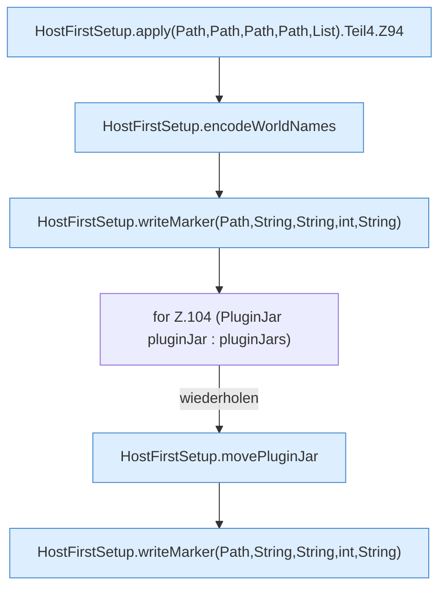

[[00 Start]] › [[Host-Betrieb]] › [[Host-Ersteinrichtung]] › [[HostFirstSetup]] › [[HostFirstSetup.Teil1]] › [[HostFirstSetup.apply(Path,Path,Path,Path,List)]] › [[HostFirstSetup.apply(Path,Path,Path,Path,List).Teil4]]

# HostFirstSetup.apply(Path,Path,Path,Path,List).Teil4



```knoten
HostFirstSetup.apply(Path,Path,Path,Path,List).Teil4.Z94
  Der Ablauf geht in [[Glossar#Zeile|Zeile]] 94 weiter. Eine Ebene tiefer steht er genauer. Fortsetzung des Ablaufs ab Zeile 94.
HostFirstSetup.encodeWorldNames
  Die [[Glossar#Ersteinrichtung|Ersteinrichtung]] kümmert sich um die [[Glossar#Spielwelt|Spielwelt]] die Namen. Kodiert `encodeWorldNames`.
HostFirstSetup.writeMarker(Path,String,String,int,String)
  Die [[Glossar#Ersteinrichtung|Ersteinrichtung]] schreibt die Merkdatei. Schreibt `writeMarker`.
for Z.104 (PluginJar pluginJar : pluginJars)
  Zeile 104: Schleife `(PluginJar pluginJar : pluginJars)`.
HostFirstSetup.movePluginJar
  Die [[Glossar#Ersteinrichtung|Ersteinrichtung]] kümmert sich um das [[Glossar#Plugin|Plugin]] die [[Glossar#Programmdatei|Programmdatei]]. Verschiebt `movePluginJar`.
```

> [!knoten]- Was die Blöcke tun
> - **HostFirstSetup.apply(Path,Path,Path,Path,List).Teil4.Z94**: Der Ablauf geht in [[Glossar#Zeile|Zeile]] 94 weiter. Eine Ebene tiefer steht er genauer. Fortsetzung des Ablaufs ab Zeile 94.
> - **HostFirstSetup.encodeWorldNames**: Die [[Glossar#Ersteinrichtung|Ersteinrichtung]] kümmert sich um die [[Glossar#Spielwelt|Spielwelt]] die Namen. Kodiert `encodeWorldNames`.
> - **HostFirstSetup.writeMarker(Path,String,String,int,String)**: Die [[Glossar#Ersteinrichtung|Ersteinrichtung]] schreibt die Merkdatei. Schreibt `writeMarker`.
> - **for Z.104 (PluginJar pluginJar : pluginJars)**: Zeile 104: Schleife `(PluginJar pluginJar : pluginJars)`.
> - **HostFirstSetup.movePluginJar**: Die [[Glossar#Ersteinrichtung|Ersteinrichtung]] kümmert sich um das [[Glossar#Plugin|Plugin]] die [[Glossar#Programmdatei|Programmdatei]]. Verschiebt `movePluginJar`.

- Ein weiterer Abschnitt derselben Übersicht.
- Fortsetzung von `HostFirstSetup.apply(Path,Path,Path,Path,List)`.
