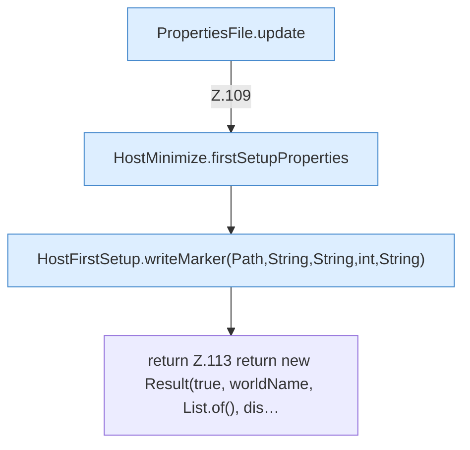

[[00 Start]] › [[Host-Betrieb]] › [[Host-Ersteinrichtung]] › [[HostFirstSetup]] › [[HostFirstSetup.Teil1]] › [[HostFirstSetup.apply(Path,Path,Path,Path,List)]] › [[HostFirstSetup.apply(Path,Path,Path,Path,List).Teil5]]

# HostFirstSetup.apply(Path,Path,Path,Path,List).Teil5



```knoten
PropertiesFile.update
  Aktualisiert `update`.
HostMinimize.firstSetupProperties
  `firstSetupProperties` in `HostMinimize.java`.
HostFirstSetup.writeMarker(Path,String,String,int,String)
  Schreibt `writeMarker`.
return Z.113 return new Result(true, worldName, List.of(), dis…
  Zeile 113: Rückgabe `return new Result(true, worldName, List.of(), dis…`.
```

- Fortsetzung von `HostFirstSetup.apply(Path,Path,Path,Path,List)`, Quellreihenfolge.
