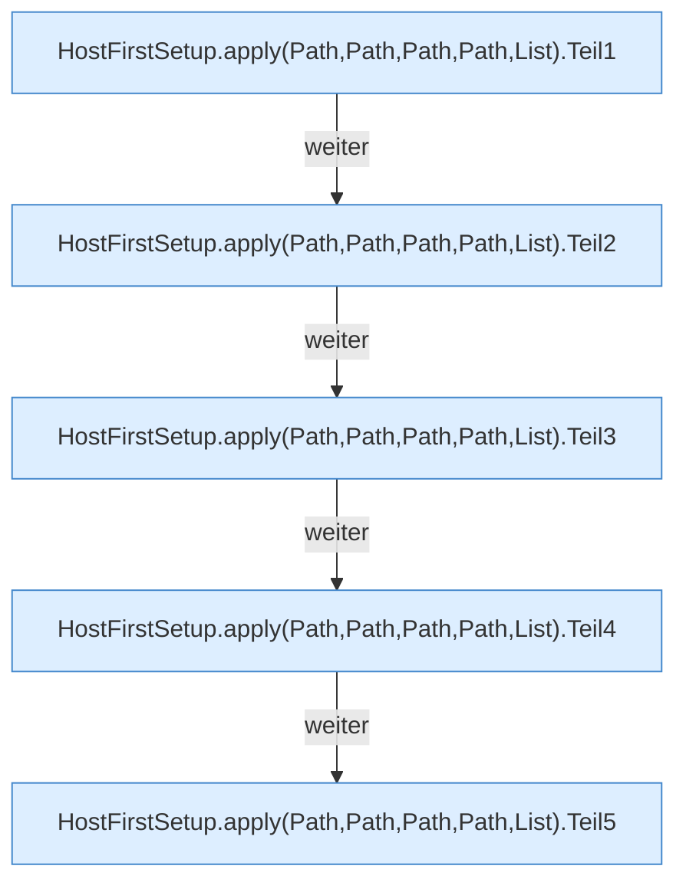

[[00 Start]] › [[Host-Betrieb]] › [[Host-Ersteinrichtung]] › [[HostFirstSetup]] › [[HostFirstSetup.Teil1]] › [[HostFirstSetup.apply(Path,Path,Path,Path,List)]]

# HostFirstSetup.apply(Path,Path,Path,Path,List)

`HostFirstSetup.apply(Path root, Path marker, Path childDirectory, Path runningPluginJar, List<Path> additionalProtectedPaths)` [src/main/java/de/aichele/childlauncher/HostFirstSetup.java:62–114](https://github.com/Sciddie/minecraft-serverhoster-plugin/blob/95b02b953b0b4c23673e900e021a7c3c844aa37d/src/main/java/de/aichele/childlauncher/HostFirstSetup.java#L62-L114)



```knoten
HostFirstSetup.apply(Path,Path,Path,Path,List).Teil1
  Ein weiterer Abschnitt derselben Übersicht. Abschnitt 1 dieses Ablaufs, in Quellreihenfolge.
HostFirstSetup.apply(Path,Path,Path,Path,List).Teil2
  Ein weiterer Abschnitt derselben Übersicht. Abschnitt 2 dieses Ablaufs, in Quellreihenfolge.
HostFirstSetup.apply(Path,Path,Path,Path,List).Teil3
  Ein weiterer Abschnitt derselben Übersicht. Abschnitt 3 dieses Ablaufs, in Quellreihenfolge.
HostFirstSetup.apply(Path,Path,Path,Path,List).Teil4
  Ein weiterer Abschnitt derselben Übersicht. Abschnitt 4 dieses Ablaufs, in Quellreihenfolge.
HostFirstSetup.apply(Path,Path,Path,Path,List).Teil5
  Ein weiterer Abschnitt derselben Übersicht. Abschnitt 5 dieses Ablaufs, in Quellreihenfolge.
```

> [!knoten]- Was die Blöcke tun
> - **HostFirstSetup.apply(Path,Path,Path,Path,List).Teil1**: Ein weiterer Abschnitt derselben Übersicht. Abschnitt 1 dieses Ablaufs, in Quellreihenfolge.
> - **HostFirstSetup.apply(Path,Path,Path,Path,List).Teil2**: Ein weiterer Abschnitt derselben Übersicht. Abschnitt 2 dieses Ablaufs, in Quellreihenfolge.
> - **HostFirstSetup.apply(Path,Path,Path,Path,List).Teil3**: Ein weiterer Abschnitt derselben Übersicht. Abschnitt 3 dieses Ablaufs, in Quellreihenfolge.
> - **HostFirstSetup.apply(Path,Path,Path,Path,List).Teil4**: Ein weiterer Abschnitt derselben Übersicht. Abschnitt 4 dieses Ablaufs, in Quellreihenfolge.
> - **HostFirstSetup.apply(Path,Path,Path,Path,List).Teil5**: Ein weiterer Abschnitt derselben Übersicht. Abschnitt 5 dieses Ablaufs, in Quellreihenfolge.

- Die [[Glossar#Ersteinrichtung|Ersteinrichtung]] wendet an das.
- `apply` in `src/main/java/de/aichele/childlauncher/HostFirstSetup.java`
