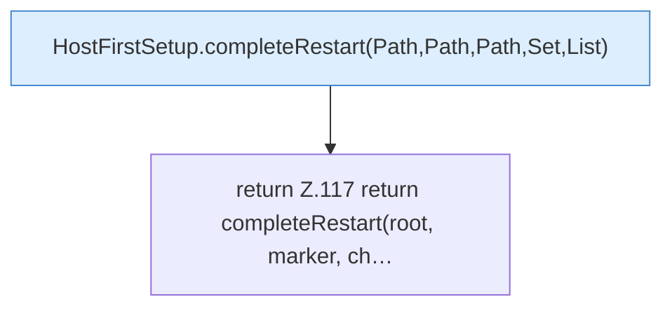

[[00 Start]] › [[Host-Betrieb]] › [[Host-Ersteinrichtung]] › [[HostFirstSetup]] › [[HostFirstSetup.Teil1]] › [[HostFirstSetup.completeRestart(Path,Path,Path,Set)]]

# HostFirstSetup.completeRestart(Path,Path,Path,Set)

`HostFirstSetup.completeRestart(Path root, Path marker, Path childDirectory, Set<String> loadedWorlds)` [src/main/java/de/aichele/childlauncher/HostFirstSetup.java:116–118](https://github.com/Sciddie/minecraft-serverhoster-plugin/blob/95b02b953b0b4c23673e900e021a7c3c844aa37d/src/main/java/de/aichele/childlauncher/HostFirstSetup.java#L116-L118)



```knoten
HostFirstSetup.completeRestart(Path,Path,Path,Set,List)
  Schließt ab `completeRestart`. Ruft `readState`, `requireRoot`, `lobbyNameSafe`.
return Z.117 return completeRestart(root, marker, ch…
  Zeile 117: Rückgabe `return completeRestart(root, marker, ch…`.
```

- `completeRestart` in `src/main/java/de/aichele/childlauncher/HostFirstSetup.java`
- Befund: toter Code, wahrscheinlich. src/main/java/de/aichele/childlauncher/HostFirstSetup.java:116–118 nur von Tests erreicht
