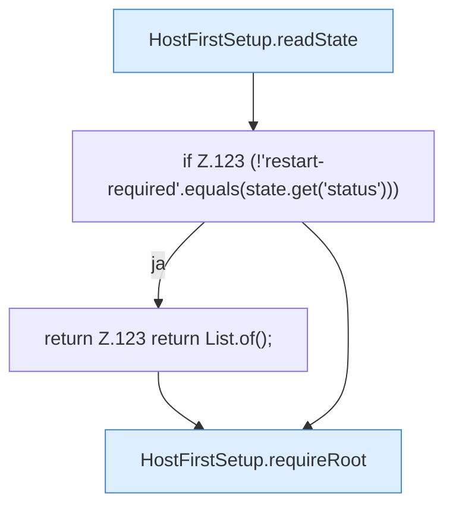

[[00 Start]] › [[Host-Betrieb]] › [[Host-Ersteinrichtung]] › [[HostFirstSetup]] › [[HostFirstSetup.Teil1]] › [[HostFirstSetup.completeRestart(Path,Path,Path,Set,List)]] › [[HostFirstSetup.completeRestart(Path,Path,Path,Set,List).Teil1]]

# HostFirstSetup.completeRestart(Path,Path,Path,Set,List).Teil1



```knoten
HostFirstSetup.readState
  Liest `readState`. Ruft `readState`.
if Z.123 (!'restart-required'.equals(state.get('status')))
  Zeile 123: prüft `(!'restart-required'.equals(state.get('status')))`.
return Z.123 return List.of();
  Zeile 123: Rückgabe `return List.of();`.
HostFirstSetup.requireRoot
  Verlangt `requireRoot`.
```

- Fortsetzung von `HostFirstSetup.completeRestart(Path,Path,Path,Set,List)`, Quellreihenfolge.
