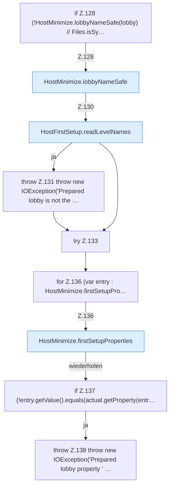

[[00 Start]] › [[Host-Betrieb]] › [[Host-Ersteinrichtung]] › [[HostFirstSetup]] › [[HostFirstSetup.Teil1]] › [[HostFirstSetup.completeRestart(Path,Path,Path,Set,List)]] › [[HostFirstSetup.completeRestart(Path,Path,Path,Set,List).Teil2]]

# HostFirstSetup.completeRestart(Path,Path,Path,Set,List).Teil2



```knoten
if Z.128 (!HostMinimize.lobbyNameSafe(lobby) // Files.isSy…
  Zeile 128: prüft `(!HostMinimize.lobbyNameSafe(lobby) // Files.isSy…`.
HostMinimize.lobbyNameSafe
  `lobbyNameSafe` in `HostMinimize.java`.
HostFirstSetup.readLevelNames
  Liest `readLevelNames`. Ruft `safeWorldName`.
throw Z.131 throw new IOException('Prepared lobby is not the …
  Zeile 131: Abbruch `throw new IOException('Prepared lobby is not the …`.
try Z.133
  Zeile 133: Versuch. Der Fehlerpfad geht in catch.
for Z.136 (var entry : HostMinimize.firstSetupPro…
  Zeile 136: Schleife `(var entry : HostMinimize.firstSetupPro…`.
HostMinimize.firstSetupProperties
  `firstSetupProperties` in `HostMinimize.java`.
if Z.137 (!entry.getValue().equals(actual.getProperty(entr…
  Zeile 137: prüft `(!entry.getValue().equals(actual.getProperty(entr…`.
throw Z.138 throw new IOException('Prepared lobby property ' …
  Zeile 138: Abbruch `throw new IOException('Prepared lobby property ' …`.
```

- Fortsetzung von `HostFirstSetup.completeRestart(Path,Path,Path,Set,List)`, Quellreihenfolge.
