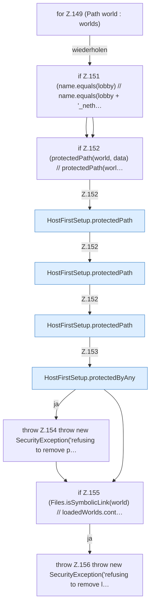

[[00 Start]] › [[Host-Betrieb]] › [[Host-Ersteinrichtung]] › [[HostFirstSetup]] › [[HostFirstSetup.Teil1]] › [[HostFirstSetup.completeRestart(Path,Path,Path,Set,List)]] › [[HostFirstSetup.completeRestart(Path,Path,Path,Set,List).Teil3.Z149]]

# HostFirstSetup.completeRestart(Path,Path,Path,Set,List).Teil3.Z149

- Fortsetzung von `HostFirstSetup.completeRestart(Path,Path,Path,Set,List).Teil3`, Quellreihenfolge.
