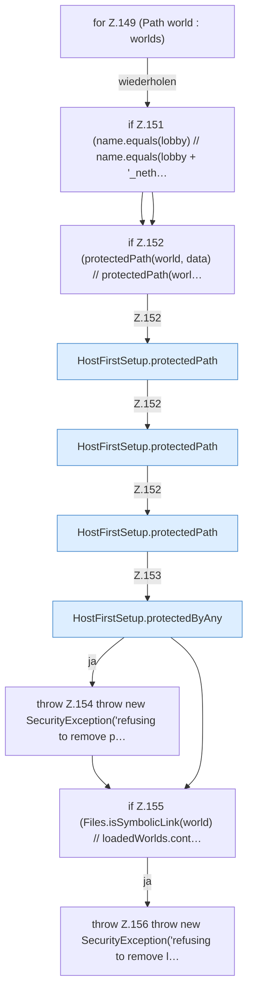

[[00 Start]] › [[Host-Betrieb]] › [[Host-Ersteinrichtung]] › [[HostFirstSetup]] › [[HostFirstSetup.Teil1]] › [[HostFirstSetup.completeRestart(Path,Path,Path,Set,List)]] › [[HostFirstSetup.completeRestart(Path,Path,Path,Set,List).Teil3.Z149]]

# HostFirstSetup.completeRestart(Path,Path,Path,Set,List).Teil3.Z149



```knoten
for Z.149 (Path world : worlds)
  Zeile 149: Schleife `(Path world : worlds)`.
if Z.151 (name.equals(lobby) // name.equals(lobby + '_neth…
  Zeile 151: prüft `(name.equals(lobby) // name.equals(lobby + '_neth…`.
if Z.152 (protectedPath(world, data) // protectedPath(worl…
  Zeile 152: prüft `(protectedPath(world, data) // protectedPath(worl…`.
HostFirstSetup.protectedPath
  Die [[Glossar#Ersteinrichtung|Ersteinrichtung]] kümmert sich um den Pfad. `protectedPath` in `HostFirstSetup.java`.
HostFirstSetup.protectedByAny
  Die [[Glossar#Ersteinrichtung|Ersteinrichtung]] macht hier einen einzelnen Schritt. Eine Ebene tiefer steht er genauer. `protectedByAny` in `HostFirstSetup.java`. Ruft `protectedPath`.
throw Z.154 throw new SecurityException('refusing to remove p…
  Zeile 154: Abbruch `throw new SecurityException('refusing to remove p…`.
if Z.155 (Files.isSymbolicLink(world) // loadedWorlds.cont…
  Zeile 155: prüft `(Files.isSymbolicLink(world) // loadedWorlds.cont…`.
throw Z.156 throw new SecurityException('refusing to remove l…
  Zeile 156: Abbruch `throw new SecurityException('refusing to remove l…`.
```

> [!knoten]- Was die Blöcke tun
> - **for Z.149 (Path world : worlds)**: Zeile 149: Schleife `(Path world : worlds)`.
> - **if Z.151 (name.equals(lobby) // name.equals(lobby + '_neth…**: Zeile 151: prüft `(name.equals(lobby) // name.equals(lobby + '_neth…`.
> - **if Z.152 (protectedPath(world, data) // protectedPath(worl…**: Zeile 152: prüft `(protectedPath(world, data) // protectedPath(worl…`.
> - **HostFirstSetup.protectedPath**: Die [[Glossar#Ersteinrichtung|Ersteinrichtung]] kümmert sich um den Pfad. `protectedPath` in `HostFirstSetup.java`.
> - **HostFirstSetup.protectedByAny**: Die [[Glossar#Ersteinrichtung|Ersteinrichtung]] macht hier einen einzelnen Schritt. Eine Ebene tiefer steht er genauer. `protectedByAny` in `HostFirstSetup.java`. Ruft `protectedPath`.
> - **throw Z.154 throw new SecurityException('refusing to remove p…**: Zeile 154: Abbruch `throw new SecurityException('refusing to remove p…`.
> - **if Z.155 (Files.isSymbolicLink(world) // loadedWorlds.cont…**: Zeile 155: prüft `(Files.isSymbolicLink(world) // loadedWorlds.cont…`.
> - **throw Z.156 throw new SecurityException('refusing to remove l…**: Zeile 156: Abbruch `throw new SecurityException('refusing to remove l…`.

- Der Ablauf geht in [[Glossar#Zeile|Zeile]] 149 weiter. Eine Ebene tiefer steht er genauer.
- Fortsetzung von `HostFirstSetup.completeRestart(Path,Path,Path,Set,List).Teil3`.
