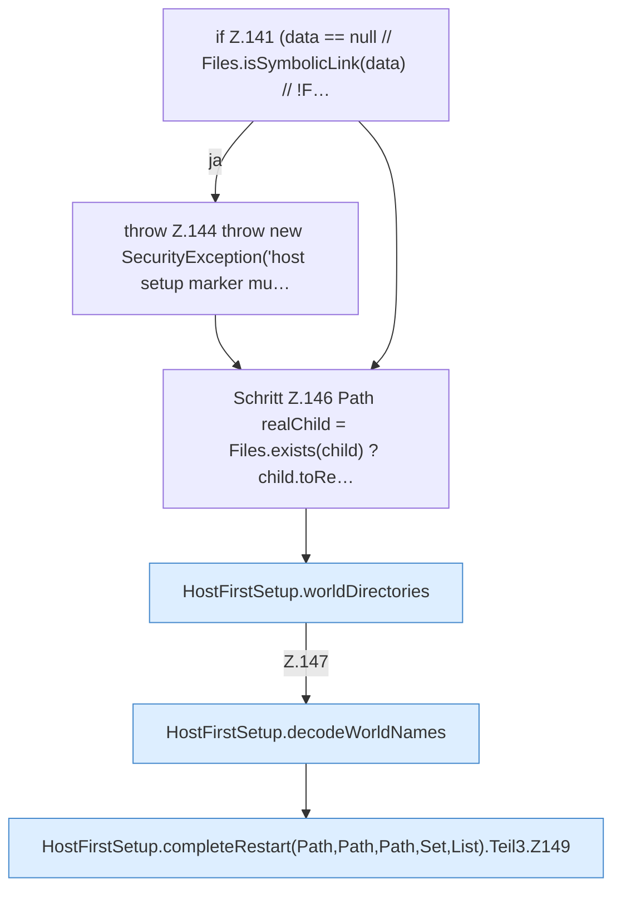

[[00 Start]] › [[Host-Betrieb]] › [[Host-Ersteinrichtung]] › [[HostFirstSetup]] › [[HostFirstSetup.Teil1]] › [[HostFirstSetup.completeRestart(Path,Path,Path,Set,List)]] › [[HostFirstSetup.completeRestart(Path,Path,Path,Set,List).Teil3]]

# HostFirstSetup.completeRestart(Path,Path,Path,Set,List).Teil3



```knoten
if Z.141 (data == null // Files.isSymbolicLink(data) // !F…
  Zeile 141: prüft `(data == null // Files.isSymbolicLink(data) // !F…`.
throw Z.144 throw new SecurityException('host setup marker mu…
  Zeile 144: Abbruch `throw new SecurityException('host setup marker mu…`.
Schritt Z.146 Path realChild = Files.exists(child) ? child.toRe…
  Zeile 146: Dateioperation. `Path realChild = Files.exists(child) ? child.toRe…`
HostFirstSetup.worldDirectories
  Die [[Glossar#Ersteinrichtung|Ersteinrichtung]] macht hier einen einzelnen Schritt. Eine Ebene tiefer steht er genauer. Betrifft die Welt `worldDirectories`. Ruft `safeWorldName`, `addIfDirectory`.
HostFirstSetup.decodeWorldNames
  Die [[Glossar#Ersteinrichtung|Ersteinrichtung]] kümmert sich um die [[Glossar#Spielwelt|Spielwelt]] die Namen. Dekodiert `decodeWorldNames`. Ruft `safeWorldName`.
HostFirstSetup.completeRestart(Path,Path,Path,Set,List).Teil3.Z149
  Der Ablauf geht in [[Glossar#Zeile|Zeile]] 149 weiter. Eine Ebene tiefer steht er genauer. Fortsetzung des Ablaufs ab Zeile 149.
```

> [!knoten]- Was die Blöcke tun
> - **if Z.141 (data == null // Files.isSymbolicLink(data) // !F…**: Zeile 141: prüft `(data == null // Files.isSymbolicLink(data) // !F…`.
> - **throw Z.144 throw new SecurityException('host setup marker mu…**: Zeile 144: Abbruch `throw new SecurityException('host setup marker mu…`.
> - **Schritt Z.146 Path realChild = Files.exists(child) ? child.toRe…**: Zeile 146: Dateioperation. `Path realChild = Files.exists(child) ? child.toRe…`
> - **HostFirstSetup.worldDirectories**: Die [[Glossar#Ersteinrichtung|Ersteinrichtung]] macht hier einen einzelnen Schritt. Eine Ebene tiefer steht er genauer. Betrifft die Welt `worldDirectories`. Ruft `safeWorldName`, `addIfDirectory`.
> - **HostFirstSetup.decodeWorldNames**: Die [[Glossar#Ersteinrichtung|Ersteinrichtung]] kümmert sich um die [[Glossar#Spielwelt|Spielwelt]] die Namen. Dekodiert `decodeWorldNames`. Ruft `safeWorldName`.
> - **HostFirstSetup.completeRestart(Path,Path,Path,Set,List).Teil3.Z149**: Der Ablauf geht in [[Glossar#Zeile|Zeile]] 149 weiter. Eine Ebene tiefer steht er genauer. Fortsetzung des Ablaufs ab Zeile 149.

- Ein weiterer Abschnitt derselben Übersicht.
- Fortsetzung von `HostFirstSetup.completeRestart(Path,Path,Path,Set,List)`.
