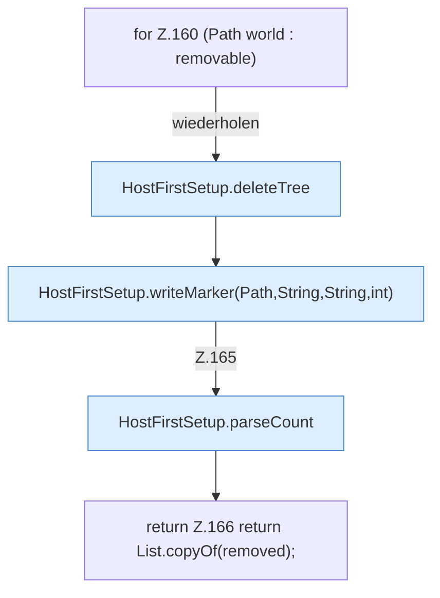

[[00 Start]] › [[Host-Betrieb]] › [[Host-Ersteinrichtung]] › [[HostFirstSetup]] › [[HostFirstSetup.Teil1]] › [[HostFirstSetup.completeRestart(Path,Path,Path,Set,List)]] › [[HostFirstSetup.completeRestart(Path,Path,Path,Set,List).Teil4]]

# HostFirstSetup.completeRestart(Path,Path,Path,Set,List).Teil4



```knoten
for Z.160 (Path world : removable)
  Zeile 160: Schleife `(Path world : removable)`.
HostFirstSetup.deleteTree
  Die [[Glossar#Ersteinrichtung|Ersteinrichtung]] löscht hier einen Schritt. Eine Ebene tiefer steht er genauer. Löscht `deleteTree`. Ruft `visitFile`, `postVisitDirectory`.
HostFirstSetup.writeMarker(Path,String,String,int)
  Die [[Glossar#Ersteinrichtung|Ersteinrichtung]] schreibt die Merkdatei. Schreibt `writeMarker`. Ruft `writeMarker`.
HostFirstSetup.parseCount
  Die [[Glossar#Ersteinrichtung|Ersteinrichtung]] liest hier einen Schritt. Eine Ebene tiefer steht er genauer. Wertet aus `parseCount`.
return Z.166 return List.copyOf(removed);
  Zeile 166: Rückgabe `return List.copyOf(removed);`.
```

> [!knoten]- Was die Blöcke tun
> - **for Z.160 (Path world : removable)**: Zeile 160: Schleife `(Path world : removable)`.
> - **HostFirstSetup.deleteTree**: Die [[Glossar#Ersteinrichtung|Ersteinrichtung]] löscht hier einen Schritt. Eine Ebene tiefer steht er genauer. Löscht `deleteTree`. Ruft `visitFile`, `postVisitDirectory`.
> - **HostFirstSetup.writeMarker(Path,String,String,int)**: Die [[Glossar#Ersteinrichtung|Ersteinrichtung]] schreibt die Merkdatei. Schreibt `writeMarker`. Ruft `writeMarker`.
> - **HostFirstSetup.parseCount**: Die [[Glossar#Ersteinrichtung|Ersteinrichtung]] liest hier einen Schritt. Eine Ebene tiefer steht er genauer. Wertet aus `parseCount`.
> - **return Z.166 return List.copyOf(removed);**: Zeile 166: Rückgabe `return List.copyOf(removed);`.

- Ein weiterer Abschnitt derselben Übersicht.
- Fortsetzung von `HostFirstSetup.completeRestart(Path,Path,Path,Set,List)`.
