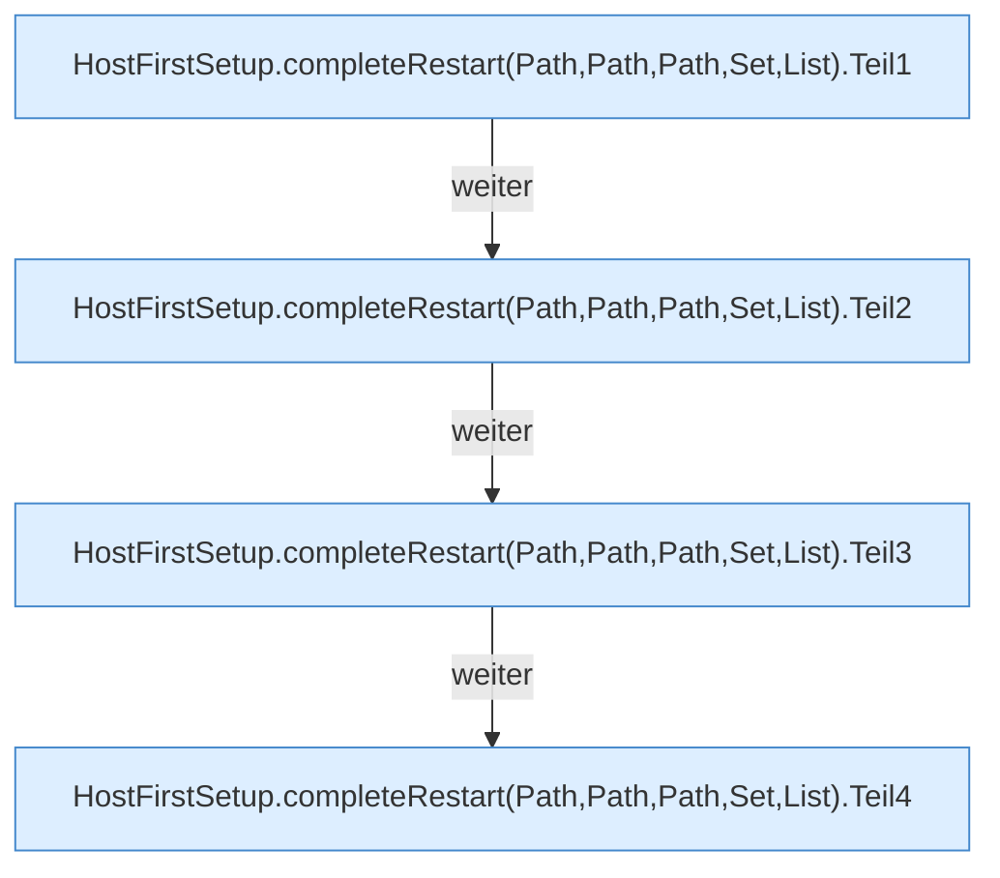

[[00 Start]] › [[Host-Betrieb]] › [[Host-Ersteinrichtung]] › [[HostFirstSetup]] › [[HostFirstSetup.Teil1]] › [[HostFirstSetup.completeRestart(Path,Path,Path,Set,List)]]

# HostFirstSetup.completeRestart(Path,Path,Path,Set,List)

`HostFirstSetup.completeRestart(Path root, Path marker, Path childDirectory, Set<String> loadedWorlds, List<Path> additionalProtectedPaths)` [src/main/java/de/aichele/childlauncher/HostFirstSetup.java:120–167](https://github.com/Sciddie/minecraft-serverhoster-plugin/blob/95b02b953b0b4c23673e900e021a7c3c844aa37d/src/main/java/de/aichele/childlauncher/HostFirstSetup.java#L120-L167)

- `completeRestart` in `src/main/java/de/aichele/childlauncher/HostFirstSetup.java`
