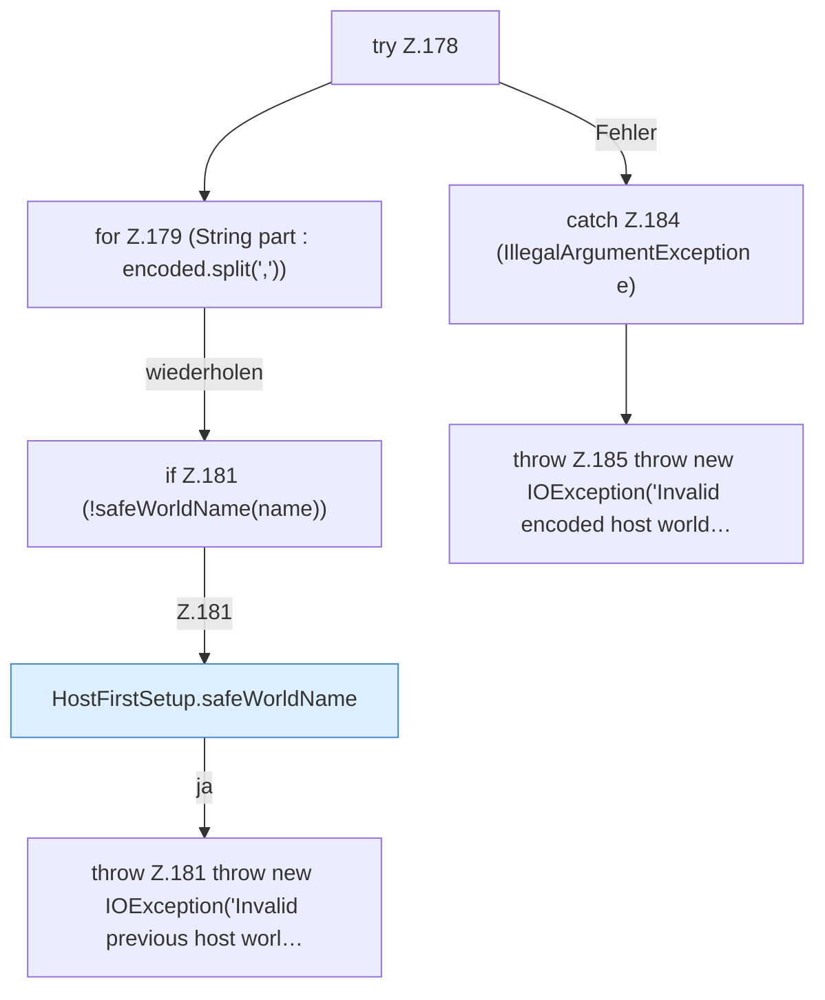

[[00 Start]] › [[Host-Betrieb]] › [[Host-Ersteinrichtung]] › [[HostFirstSetup]] › [[HostFirstSetup.Teil2]] › [[HostFirstSetup.decodeWorldNames]] › [[HostFirstSetup.decodeWorldNames.Z178]]

# HostFirstSetup.decodeWorldNames.Z178

- Fortsetzung von `HostFirstSetup.decodeWorldNames`, Quellreihenfolge.
