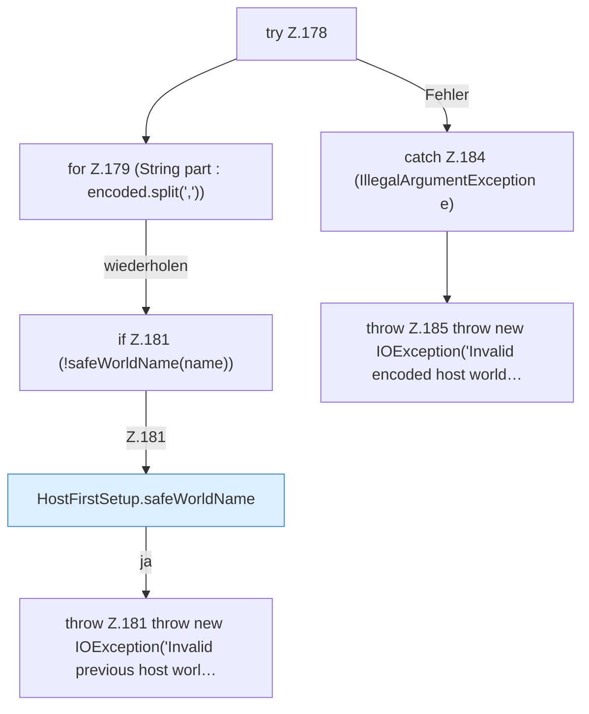

[[00 Start]] › [[Host-Betrieb]] › [[Host-Ersteinrichtung]] › [[HostFirstSetup]] › [[HostFirstSetup.Teil2]] › [[HostFirstSetup.decodeWorldNames]] › [[HostFirstSetup.decodeWorldNames.Z178]]

# HostFirstSetup.decodeWorldNames.Z178



```knoten
try Z.178
  Zeile 178: Versuch. Der Fehlerpfad geht in catch.
for Z.179 (String part : encoded.split(','))
  Zeile 179: Schleife `(String part : encoded.split(','))`.
if Z.181 (!safeWorldName(name))
  Zeile 181: prüft `(!safeWorldName(name))`.
HostFirstSetup.safeWorldName
  Die [[Glossar#Ersteinrichtung|Ersteinrichtung]] kümmert sich um die [[Glossar#Spielwelt|Spielwelt]] den Namen. Prüft die Pfadgrenze `safeWorldName`.
throw Z.181 throw new IOException('Invalid previous host worl…
  Zeile 181: Abbruch `throw new IOException('Invalid previous host worl…`.
catch Z.184 (IllegalArgumentException e)
  Zeile 184: fängt (IllegalArgumentException e).
throw Z.185 throw new IOException('Invalid encoded host world…
  Zeile 185: Abbruch `throw new IOException('Invalid encoded host world…`.
```

> [!knoten]- Was die Blöcke tun
> - **try Z.178**: Zeile 178: Versuch. Der Fehlerpfad geht in catch.
> - **for Z.179 (String part : encoded.split(','))**: Zeile 179: Schleife `(String part : encoded.split(','))`.
> - **if Z.181 (!safeWorldName(name))**: Zeile 181: prüft `(!safeWorldName(name))`.
> - **HostFirstSetup.safeWorldName**: Die [[Glossar#Ersteinrichtung|Ersteinrichtung]] kümmert sich um die [[Glossar#Spielwelt|Spielwelt]] den Namen. Prüft die Pfadgrenze `safeWorldName`.
> - **throw Z.181 throw new IOException('Invalid previous host worl…**: Zeile 181: Abbruch `throw new IOException('Invalid previous host worl…`.
> - **catch Z.184 (IllegalArgumentException e)**: Zeile 184: fängt (IllegalArgumentException e).
> - **throw Z.185 throw new IOException('Invalid encoded host world…**: Zeile 185: Abbruch `throw new IOException('Invalid encoded host world…`.

- Der Ablauf geht in [[Glossar#Zeile|Zeile]] 178 weiter. Eine Ebene tiefer steht er genauer.
- Fortsetzung von `HostFirstSetup.decodeWorldNames`.
