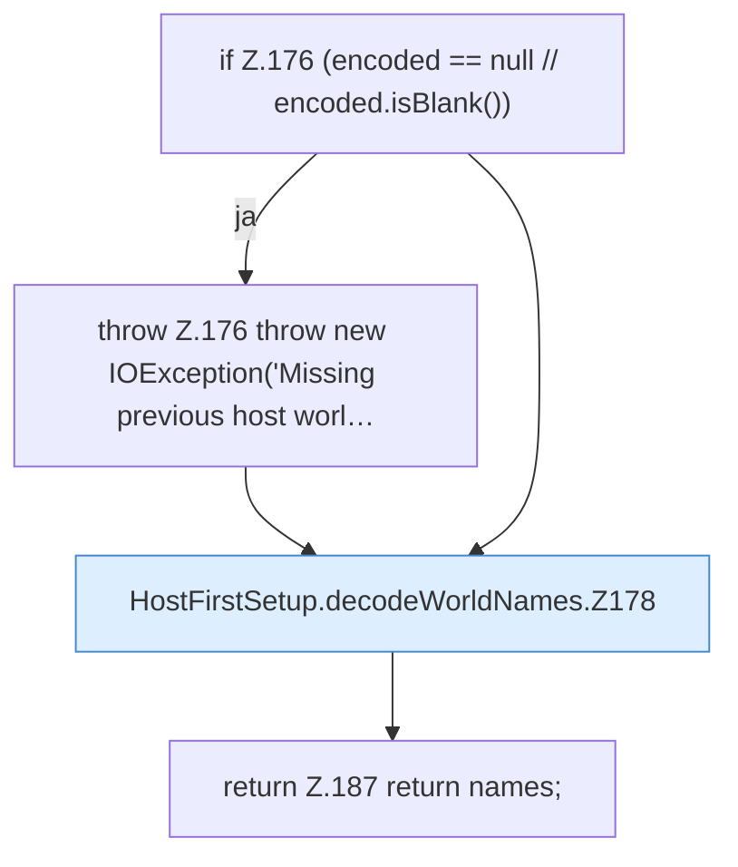

[[00 Start]] › [[Host-Betrieb]] › [[Host-Ersteinrichtung]] › [[HostFirstSetup]] › [[HostFirstSetup.Teil2]] › [[HostFirstSetup.decodeWorldNames]]

# HostFirstSetup.decodeWorldNames

`HostFirstSetup.decodeWorldNames(String encoded)` [src/main/java/de/aichele/childlauncher/HostFirstSetup.java:175–188](https://github.com/Sciddie/minecraft-serverhoster-plugin/blob/95b02b953b0b4c23673e900e021a7c3c844aa37d/src/main/java/de/aichele/childlauncher/HostFirstSetup.java#L175-L188)



```knoten
if Z.176 (encoded == null // encoded.isBlank())
  Zeile 176: prüft `(encoded == null // encoded.isBlank())`.
throw Z.176 throw new IOException('Missing previous host worl…
  Zeile 176: Abbruch `throw new IOException('Missing previous host worl…`.
HostFirstSetup.decodeWorldNames.Z178
  Der Ablauf geht in [[Glossar#Zeile|Zeile]] 178 weiter. Eine Ebene tiefer steht er genauer. Fortsetzung des Ablaufs ab Zeile 178.
return Z.187 return names;
  Zeile 187: Rückgabe `return names;`.
```

> [!knoten]- Was die Blöcke tun
> - **if Z.176 (encoded == null // encoded.isBlank())**: Zeile 176: prüft `(encoded == null // encoded.isBlank())`.
> - **throw Z.176 throw new IOException('Missing previous host worl…**: Zeile 176: Abbruch `throw new IOException('Missing previous host worl…`.
> - **HostFirstSetup.decodeWorldNames.Z178**: Der Ablauf geht in [[Glossar#Zeile|Zeile]] 178 weiter. Eine Ebene tiefer steht er genauer. Fortsetzung des Ablaufs ab Zeile 178.
> - **return Z.187 return names;**: Zeile 187: Rückgabe `return names;`.

- Die [[Glossar#Ersteinrichtung|Ersteinrichtung]] kümmert sich um die [[Glossar#Spielwelt|Spielwelt]] die Namen.
- `decodeWorldNames` in `src/main/java/de/aichele/childlauncher/HostFirstSetup.java`
