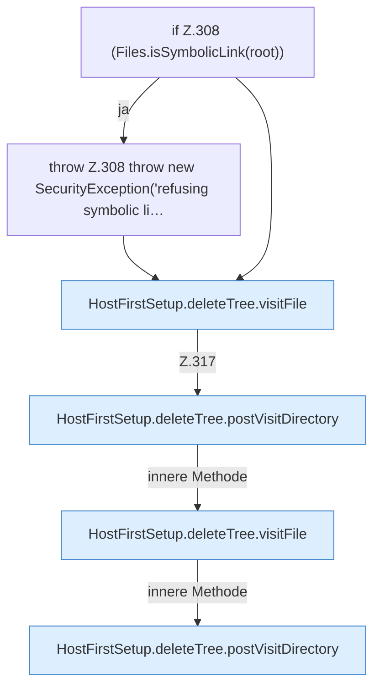

[[00 Start]] › [[Host-Betrieb]] › [[Host-Ersteinrichtung]] › [[HostFirstSetup]] › [[HostFirstSetup.Teil3]] › [[HostFirstSetup.deleteTree]]

# HostFirstSetup.deleteTree

`HostFirstSetup.deleteTree(Path root)` [src/main/java/de/aichele/childlauncher/HostFirstSetup.java:307–323](https://github.com/Sciddie/minecraft-serverhoster-plugin/blob/95b02b953b0b4c23673e900e021a7c3c844aa37d/src/main/java/de/aichele/childlauncher/HostFirstSetup.java#L307-L323)



```knoten
if Z.308 (Files.isSymbolicLink(root))
  Zeile 308: prüft `(Files.isSymbolicLink(root))`.
throw Z.308 throw new SecurityException('refusing symbolic li…
  Zeile 308: Abbruch `throw new SecurityException('refusing symbolic li…`.
HostFirstSetup.deleteTree.visitFile
  Die [[Glossar#Ersteinrichtung|Ersteinrichtung]] kümmert sich um die Datei. `visitFile` in `HostFirstSetup.java`.
HostFirstSetup.deleteTree.postVisitDirectory
  Die [[Glossar#Ersteinrichtung|Ersteinrichtung]] schickt hier einen Schritt. Eine Ebene tiefer steht er genauer. Sendet POST `postVisitDirectory`.
```

> [!knoten]- Was die Blöcke tun
> - **if Z.308 (Files.isSymbolicLink(root))**: Zeile 308: prüft `(Files.isSymbolicLink(root))`.
> - **throw Z.308 throw new SecurityException('refusing symbolic li…**: Zeile 308: Abbruch `throw new SecurityException('refusing symbolic li…`.
> - **HostFirstSetup.deleteTree.visitFile**: Die [[Glossar#Ersteinrichtung|Ersteinrichtung]] kümmert sich um die Datei. `visitFile` in `HostFirstSetup.java`.
> - **HostFirstSetup.deleteTree.postVisitDirectory**: Die [[Glossar#Ersteinrichtung|Ersteinrichtung]] schickt hier einen Schritt. Eine Ebene tiefer steht er genauer. Sendet POST `postVisitDirectory`.

- Die [[Glossar#Ersteinrichtung|Ersteinrichtung]] löscht hier einen Schritt. Eine Ebene tiefer steht er genauer.
- `deleteTree` in `src/main/java/de/aichele/childlauncher/HostFirstSetup.java`
