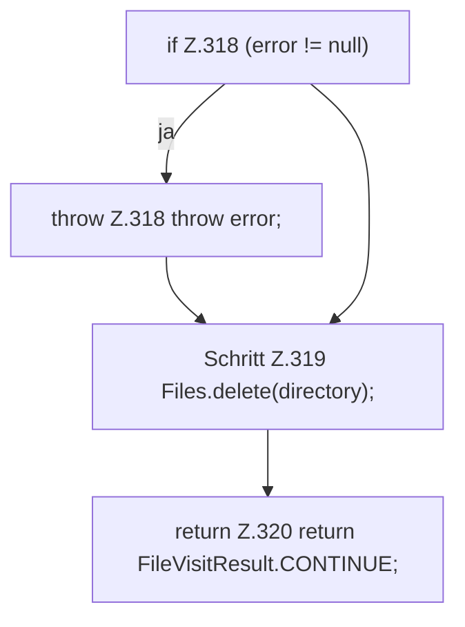

[[00 Start]] › [[Host-Betrieb]] › [[Host-Ersteinrichtung]] › [[HostFirstSetup]] › [[HostFirstSetup.Teil3]] › [[HostFirstSetup.deleteTree]] › [[HostFirstSetup.deleteTree.postVisitDirectory]]

# HostFirstSetup.deleteTree.postVisitDirectory

`HostFirstSetup.postVisitDirectory(Path directory, IOException error)` [src/main/java/de/aichele/childlauncher/HostFirstSetup.java:316–321](https://github.com/Sciddie/minecraft-serverhoster-plugin/blob/95b02b953b0b4c23673e900e021a7c3c844aa37d/src/main/java/de/aichele/childlauncher/HostFirstSetup.java#L316-L321)

- `postVisitDirectory` in `src/main/java/de/aichele/childlauncher/HostFirstSetup.java`
