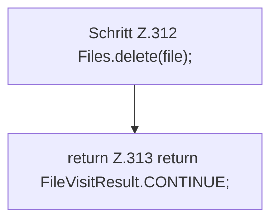

[[00 Start]] › [[Host-Betrieb]] › [[Host-Ersteinrichtung]] › [[HostFirstSetup]] › [[HostFirstSetup.Teil3]] › [[HostFirstSetup.deleteTree]] › [[HostFirstSetup.deleteTree.visitFile]]

# HostFirstSetup.deleteTree.visitFile

`HostFirstSetup.visitFile(Path file, BasicFileAttributes attributes)` [src/main/java/de/aichele/childlauncher/HostFirstSetup.java:310–314](https://github.com/Sciddie/minecraft-serverhoster-plugin/blob/95b02b953b0b4c23673e900e021a7c3c844aa37d/src/main/java/de/aichele/childlauncher/HostFirstSetup.java#L310-L314)



```knoten
Schritt Z.312 Files.delete(file);
  Zeile 312: Dateioperation. `Files.delete(file);`
return Z.313 return FileVisitResult.CONTINUE;
  Zeile 313: Rückgabe `return FileVisitResult.CONTINUE;`.
```

- `visitFile` in `src/main/java/de/aichele/childlauncher/HostFirstSetup.java`
