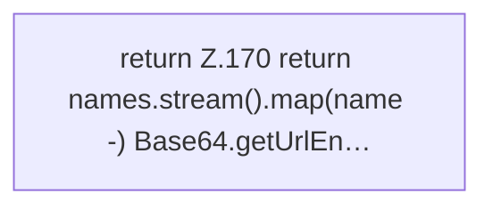

[[00 Start]] › [[Host-Betrieb]] › [[Host-Ersteinrichtung]] › [[HostFirstSetup]] › [[HostFirstSetup.Teil1]] › [[HostFirstSetup.encodeWorldNames]]

# HostFirstSetup.encodeWorldNames

`HostFirstSetup.encodeWorldNames(List<String> names)` [src/main/java/de/aichele/childlauncher/HostFirstSetup.java:169–173](https://github.com/Sciddie/minecraft-serverhoster-plugin/blob/95b02b953b0b4c23673e900e021a7c3c844aa37d/src/main/java/de/aichele/childlauncher/HostFirstSetup.java#L169-L173)



```knoten
return Z.170 return names.stream().map(name -) Base64.getUrlEn…
  Zeile 170: Rückgabe `return names.stream().map(name -) Base64.getUrlEn…`.
```

> [!knoten]- Was die Blöcke tun
> - **return Z.170 return names.stream().map(name -) Base64.getUrlEn…**: Zeile 170: Rückgabe `return names.stream().map(name -) Base64.getUrlEn…`.

- Die [[Glossar#Ersteinrichtung|Ersteinrichtung]] kümmert sich um die [[Glossar#Spielwelt|Spielwelt]] die Namen.
- `encodeWorldNames` in `src/main/java/de/aichele/childlauncher/HostFirstSetup.java`
