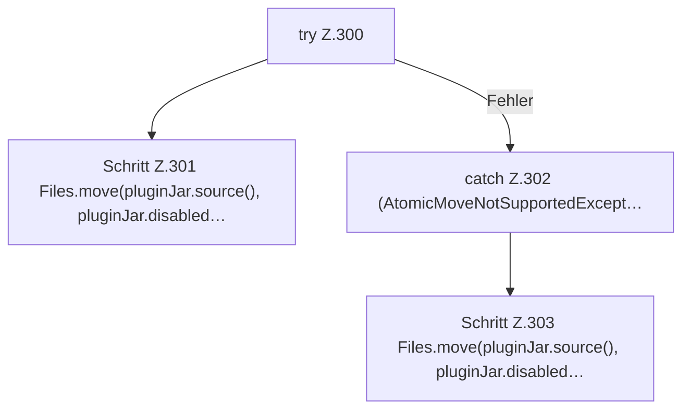

[[00 Start]] › [[Host-Betrieb]] › [[Host-Ersteinrichtung]] › [[HostFirstSetup]] › [[HostFirstSetup.Teil3]] › [[HostFirstSetup.movePluginJar]]

# HostFirstSetup.movePluginJar

`HostFirstSetup.movePluginJar(PluginJar pluginJar)` [src/main/java/de/aichele/childlauncher/HostFirstSetup.java:299–305](https://github.com/Sciddie/minecraft-serverhoster-plugin/blob/95b02b953b0b4c23673e900e021a7c3c844aa37d/src/main/java/de/aichele/childlauncher/HostFirstSetup.java#L299-L305)

- `movePluginJar` in `src/main/java/de/aichele/childlauncher/HostFirstSetup.java`
