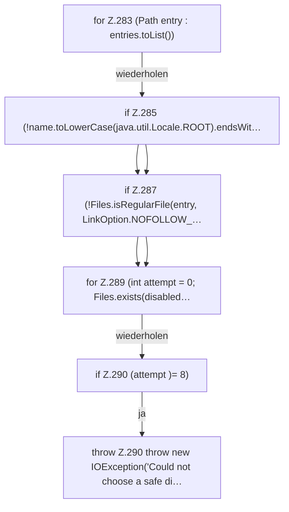

[[00 Start]] › [[Host-Betrieb]] › [[Host-Ersteinrichtung]] › [[HostFirstSetup]] › [[HostFirstSetup.Teil3]] › [[HostFirstSetup.otherPluginJars]] › [[HostFirstSetup.otherPluginJars.Z282.Z283]]

# HostFirstSetup.otherPluginJars.Z282.Z283



```knoten
for Z.283 (Path entry : entries.toList())
  Zeile 283: Schleife `(Path entry : entries.toList())`.
if Z.285 (!name.toLowerCase(java.util.Locale.ROOT).endsWit…
  Zeile 285: prüft `(!name.toLowerCase(java.util.Locale.ROOT).endsWit…`.
if Z.287 (!Files.isRegularFile(entry, LinkOption.NOFOLLOW_…
  Zeile 287: prüft `(!Files.isRegularFile(entry, LinkOption.NOFOLLOW_…`.
for Z.289 (int attempt = 0; Files.exists(disabled…
  Zeile 289: Schleife `(int attempt = 0; Files.exists(disabled…`.
if Z.290 (attempt )= 8)
  Zeile 290: prüft `(attempt )= 8)`.
throw Z.290 throw new IOException('Could not choose a safe di…
  Zeile 290: Abbruch `throw new IOException('Could not choose a safe di…`.
```

> [!knoten]- Was die Blöcke tun
> - **for Z.283 (Path entry : entries.toList())**: Zeile 283: Schleife `(Path entry : entries.toList())`.
> - **if Z.285 (!name.toLowerCase(java.util.Locale.ROOT).endsWit…**: Zeile 285: prüft `(!name.toLowerCase(java.util.Locale.ROOT).endsWit…`.
> - **if Z.287 (!Files.isRegularFile(entry, LinkOption.NOFOLLOW_…**: Zeile 287: prüft `(!Files.isRegularFile(entry, LinkOption.NOFOLLOW_…`.
> - **for Z.289 (int attempt = 0; Files.exists(disabled…**: Zeile 289: Schleife `(int attempt = 0; Files.exists(disabled…`.
> - **if Z.290 (attempt )= 8)**: Zeile 290: prüft `(attempt )= 8)`.
> - **throw Z.290 throw new IOException('Could not choose a safe di…**: Zeile 290: Abbruch `throw new IOException('Could not choose a safe di…`.

- Der Ablauf geht in [[Glossar#Zeile|Zeile]] 283 weiter. Eine Ebene tiefer steht er genauer.
- Fortsetzung von `HostFirstSetup.otherPluginJars.Z282`.
