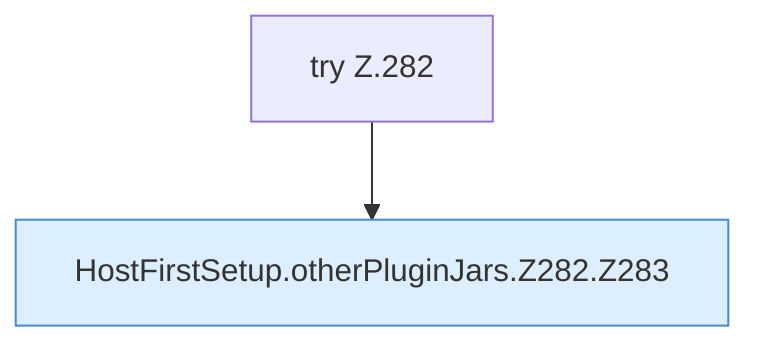

[[00 Start]] › [[Host-Betrieb]] › [[Host-Ersteinrichtung]] › [[HostFirstSetup]] › [[HostFirstSetup.Teil3]] › [[HostFirstSetup.otherPluginJars]] › [[HostFirstSetup.otherPluginJars.Z282]]

# HostFirstSetup.otherPluginJars.Z282

- Fortsetzung von `HostFirstSetup.otherPluginJars`, Quellreihenfolge.
