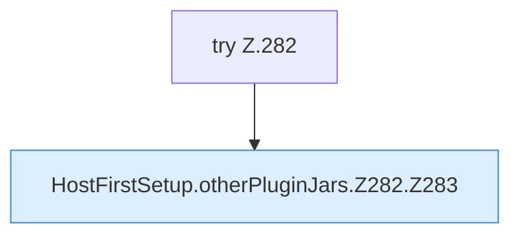

[[00 Start]] › [[Host-Betrieb]] › [[Host-Ersteinrichtung]] › [[HostFirstSetup]] › [[HostFirstSetup.Teil3]] › [[HostFirstSetup.otherPluginJars]] › [[HostFirstSetup.otherPluginJars.Z282]]

# HostFirstSetup.otherPluginJars.Z282



```knoten
try Z.282
  Zeile 282: Versuch. Der Fehlerpfad geht in catch.
HostFirstSetup.otherPluginJars.Z282.Z283
  Fortsetzung des Ablaufs ab Zeile 283.
```

- Fortsetzung von `HostFirstSetup.otherPluginJars`, Quellreihenfolge.
