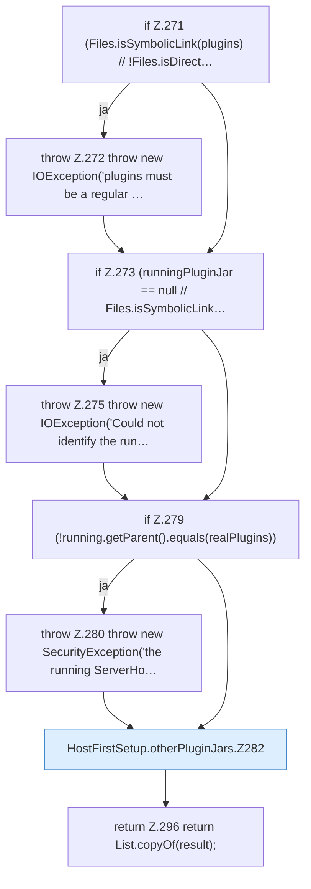

[[00 Start]] › [[Host-Betrieb]] › [[Host-Ersteinrichtung]] › [[HostFirstSetup]] › [[HostFirstSetup.Teil3]] › [[HostFirstSetup.otherPluginJars]]

# HostFirstSetup.otherPluginJars

`HostFirstSetup.otherPluginJars(Path root, Path runningPluginJar)` [src/main/java/de/aichele/childlauncher/HostFirstSetup.java:269–297](https://github.com/Sciddie/minecraft-serverhoster-plugin/blob/95b02b953b0b4c23673e900e021a7c3c844aa37d/src/main/java/de/aichele/childlauncher/HostFirstSetup.java#L269-L297)

- `otherPluginJars` in `src/main/java/de/aichele/childlauncher/HostFirstSetup.java`
