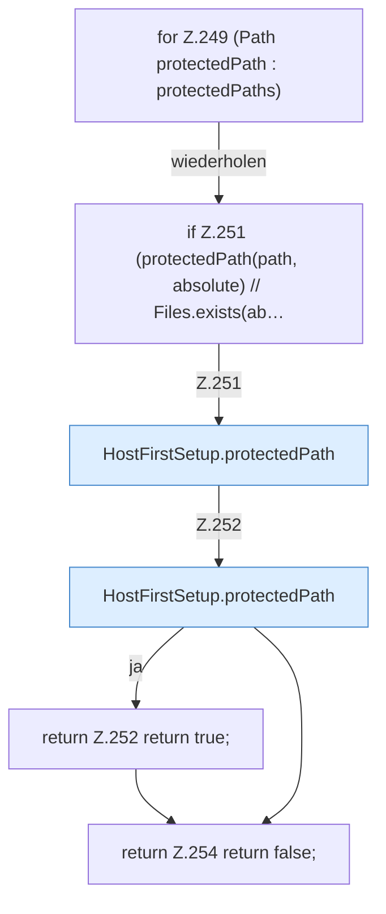

[[00 Start]] › [[Host-Betrieb]] › [[Host-Ersteinrichtung]] › [[HostFirstSetup]] › [[HostFirstSetup.Teil2]] › [[HostFirstSetup.protectedByAny]]

# HostFirstSetup.protectedByAny

`HostFirstSetup.protectedByAny(Path path, List<Path> protectedPaths)` [src/main/java/de/aichele/childlauncher/HostFirstSetup.java:248–255](https://github.com/Sciddie/minecraft-serverhoster-plugin/blob/95b02b953b0b4c23673e900e021a7c3c844aa37d/src/main/java/de/aichele/childlauncher/HostFirstSetup.java#L248-L255)



```knoten
for Z.249 (Path protectedPath : protectedPaths)
  Zeile 249: Schleife `(Path protectedPath : protectedPaths)`.
if Z.251 (protectedPath(path, absolute) // Files.exists(ab…
  Zeile 251: prüft `(protectedPath(path, absolute) // Files.exists(ab…`.
HostFirstSetup.protectedPath
  `protectedPath` in `HostFirstSetup.java`.
return Z.252 return true;
  Zeile 252: Rückgabe `return true;`.
return Z.254 return false;
  Zeile 254: Rückgabe `return false;`.
```

- `protectedByAny` in `src/main/java/de/aichele/childlauncher/HostFirstSetup.java`
