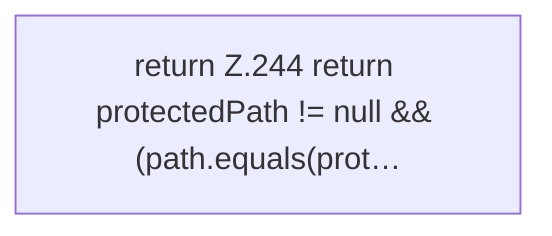

[[00 Start]] › [[Host-Betrieb]] › [[Host-Ersteinrichtung]] › [[HostFirstSetup]] › [[HostFirstSetup.Teil2]] › [[HostFirstSetup.protectedPath]]

# HostFirstSetup.protectedPath

`HostFirstSetup.protectedPath(Path path, Path protectedPath)` [src/main/java/de/aichele/childlauncher/HostFirstSetup.java:243–246](https://github.com/Sciddie/minecraft-serverhoster-plugin/blob/95b02b953b0b4c23673e900e021a7c3c844aa37d/src/main/java/de/aichele/childlauncher/HostFirstSetup.java#L243-L246)

- `protectedPath` in `src/main/java/de/aichele/childlauncher/HostFirstSetup.java`
