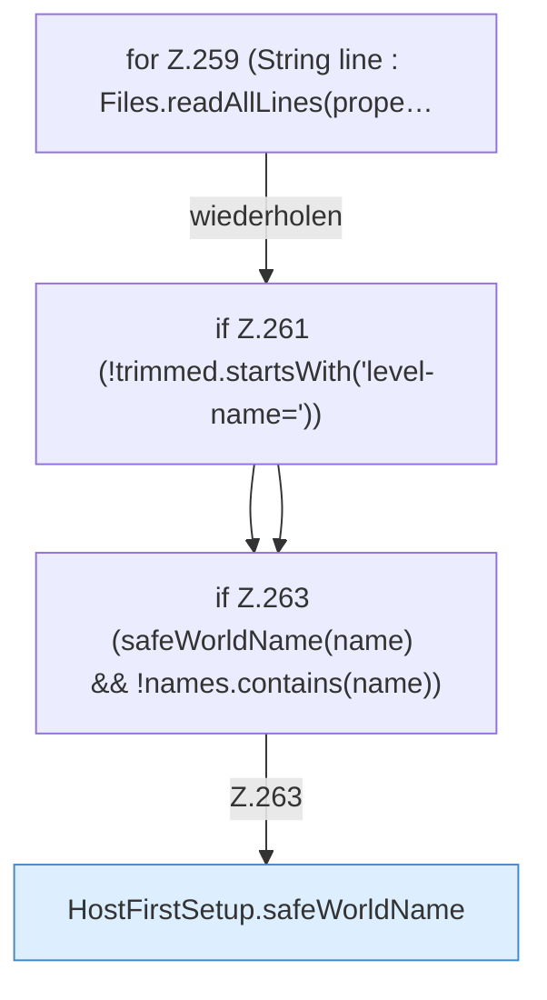

[[00 Start]] › [[Host-Betrieb]] › [[Host-Ersteinrichtung]] › [[HostFirstSetup]] › [[HostFirstSetup.Teil3]] › [[HostFirstSetup.readLevelNames]] › [[HostFirstSetup.readLevelNames.Z259]]

# HostFirstSetup.readLevelNames.Z259

- Fortsetzung von `HostFirstSetup.readLevelNames`, Quellreihenfolge.
