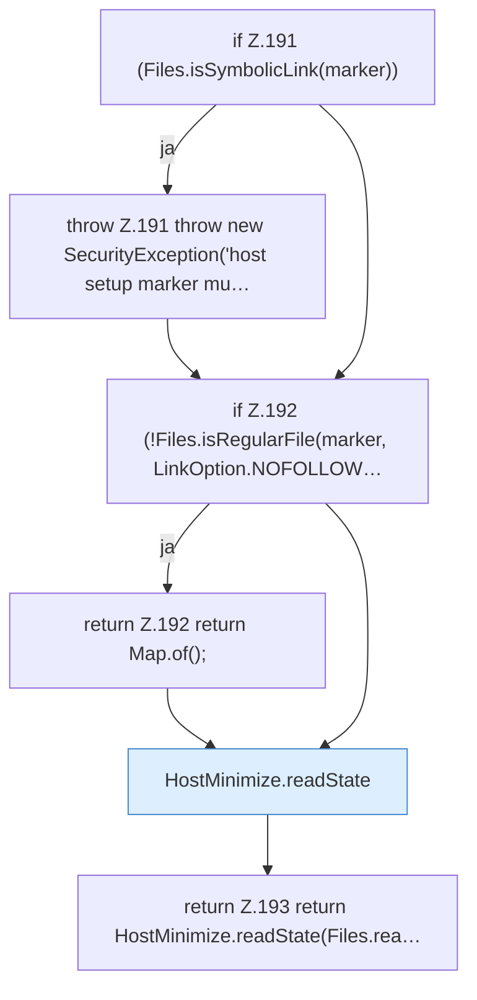

[[00 Start]] › [[Host-Betrieb]] › [[Host-Ersteinrichtung]] › [[HostFirstSetup]] › [[HostFirstSetup.Teil2]] › [[HostFirstSetup.readState]]

# HostFirstSetup.readState

`HostFirstSetup.readState(Path marker)` [src/main/java/de/aichele/childlauncher/HostFirstSetup.java:190–194](https://github.com/Sciddie/minecraft-serverhoster-plugin/blob/95b02b953b0b4c23673e900e021a7c3c844aa37d/src/main/java/de/aichele/childlauncher/HostFirstSetup.java#L190-L194)



```knoten
if Z.191 (Files.isSymbolicLink(marker))
  Zeile 191: prüft `(Files.isSymbolicLink(marker))`.
throw Z.191 throw new SecurityException('host setup marker mu…
  Zeile 191: Abbruch `throw new SecurityException('host setup marker mu…`.
if Z.192 (!Files.isRegularFile(marker, LinkOption.NOFOLLOW…
  Zeile 192: prüft `(!Files.isRegularFile(marker, LinkOption.NOFOLLOW…`.
return Z.192 return Map.of();
  Zeile 192: Rückgabe `return Map.of();`.
HostMinimize.readState
  Das Verkleinern des [[Glossar#Host|Host]] liest den Zustand. Liest `readState`.
return Z.193 return HostMinimize.readState(Files.rea…
  Zeile 193: Rückgabe `return HostMinimize.readState(Files.rea…`.
```

> [!knoten]- Was die Blöcke tun
> - **if Z.191 (Files.isSymbolicLink(marker))**: Zeile 191: prüft `(Files.isSymbolicLink(marker))`.
> - **throw Z.191 throw new SecurityException('host setup marker mu…**: Zeile 191: Abbruch `throw new SecurityException('host setup marker mu…`.
> - **if Z.192 (!Files.isRegularFile(marker, LinkOption.NOFOLLOW…**: Zeile 192: prüft `(!Files.isRegularFile(marker, LinkOption.NOFOLLOW…`.
> - **return Z.192 return Map.of();**: Zeile 192: Rückgabe `return Map.of();`.
> - **HostMinimize.readState**: Das Verkleinern des [[Glossar#Host|Host]] liest den Zustand. Liest `readState`.
> - **return Z.193 return HostMinimize.readState(Files.rea…**: Zeile 193: Rückgabe `return HostMinimize.readState(Files.rea…`.

- Die [[Glossar#Ersteinrichtung|Ersteinrichtung]] liest den Zustand.
- `readState` in `src/main/java/de/aichele/childlauncher/HostFirstSetup.java`
