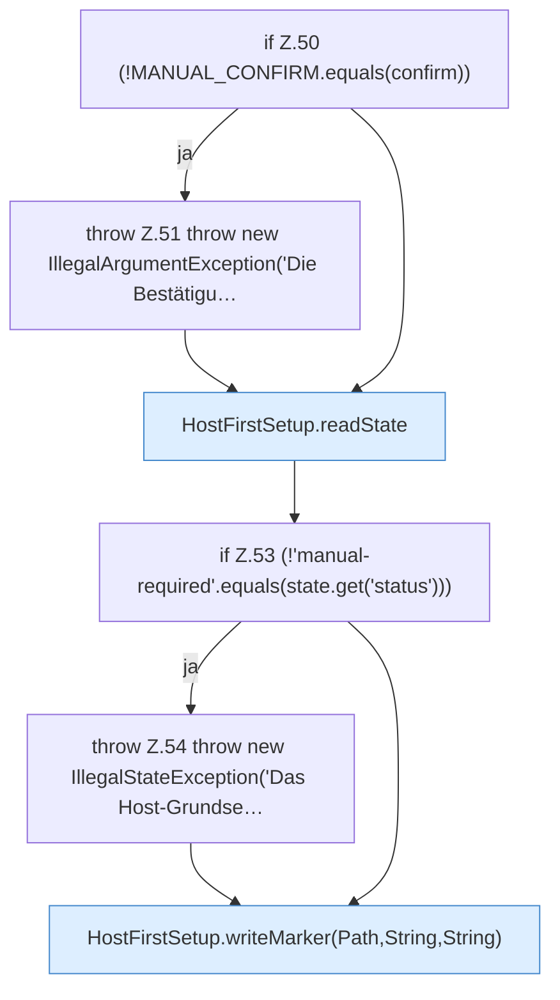

[[00 Start]] › [[Host-Betrieb]] › [[Host-Ersteinrichtung]] › [[HostFirstSetup]] › [[HostFirstSetup.Teil1]] › [[HostFirstSetup.requestManual]]

# HostFirstSetup.requestManual

`HostFirstSetup.requestManual(Path marker, String confirm)` [src/main/java/de/aichele/childlauncher/HostFirstSetup.java:49–56](https://github.com/Sciddie/minecraft-serverhoster-plugin/blob/95b02b953b0b4c23673e900e021a7c3c844aa37d/src/main/java/de/aichele/childlauncher/HostFirstSetup.java#L49-L56)



```knoten
if Z.50 (!MANUAL_CONFIRM.equals(confirm))
  Zeile 50: prüft `(!MANUAL_CONFIRM.equals(confirm))`.
throw Z.51 throw new IllegalArgumentException('Die Bestätigu…
  Zeile 51: Abbruch `throw new IllegalArgumentException('Die Bestätigu…`.
HostFirstSetup.readState
  Die [[Glossar#Ersteinrichtung|Ersteinrichtung]] liest den Zustand. Liest `readState`. Ruft `readState`.
if Z.53 (!'manual-required'.equals(state.get('status')))
  Zeile 53: prüft `(!'manual-required'.equals(state.get('status')))`.
throw Z.54 throw new IllegalStateException('Das Host-Grundse…
  Zeile 54: Abbruch `throw new IllegalStateException('Das Host-Grundse…`.
HostFirstSetup.writeMarker(Path,String,String)
  Die [[Glossar#Ersteinrichtung|Ersteinrichtung]] schreibt die Merkdatei. Schreibt `writeMarker`. Ruft `writeMarker`.
```

> [!knoten]- Was die Blöcke tun
> - **if Z.50 (!MANUAL_CONFIRM.equals(confirm))**: Zeile 50: prüft `(!MANUAL_CONFIRM.equals(confirm))`.
> - **throw Z.51 throw new IllegalArgumentException('Die Bestätigu…**: Zeile 51: Abbruch `throw new IllegalArgumentException('Die Bestätigu…`.
> - **HostFirstSetup.readState**: Die [[Glossar#Ersteinrichtung|Ersteinrichtung]] liest den Zustand. Liest `readState`. Ruft `readState`.
> - **if Z.53 (!'manual-required'.equals(state.get('status')))**: Zeile 53: prüft `(!'manual-required'.equals(state.get('status')))`.
> - **throw Z.54 throw new IllegalStateException('Das Host-Grundse…**: Zeile 54: Abbruch `throw new IllegalStateException('Das Host-Grundse…`.
> - **HostFirstSetup.writeMarker(Path,String,String)**: Die [[Glossar#Ersteinrichtung|Ersteinrichtung]] schreibt die Merkdatei. Schreibt `writeMarker`. Ruft `writeMarker`.

- Die [[Glossar#Ersteinrichtung|Ersteinrichtung]] fordert an die Handarbeit.
- `requestManual` in `src/main/java/de/aichele/childlauncher/HostFirstSetup.java`
