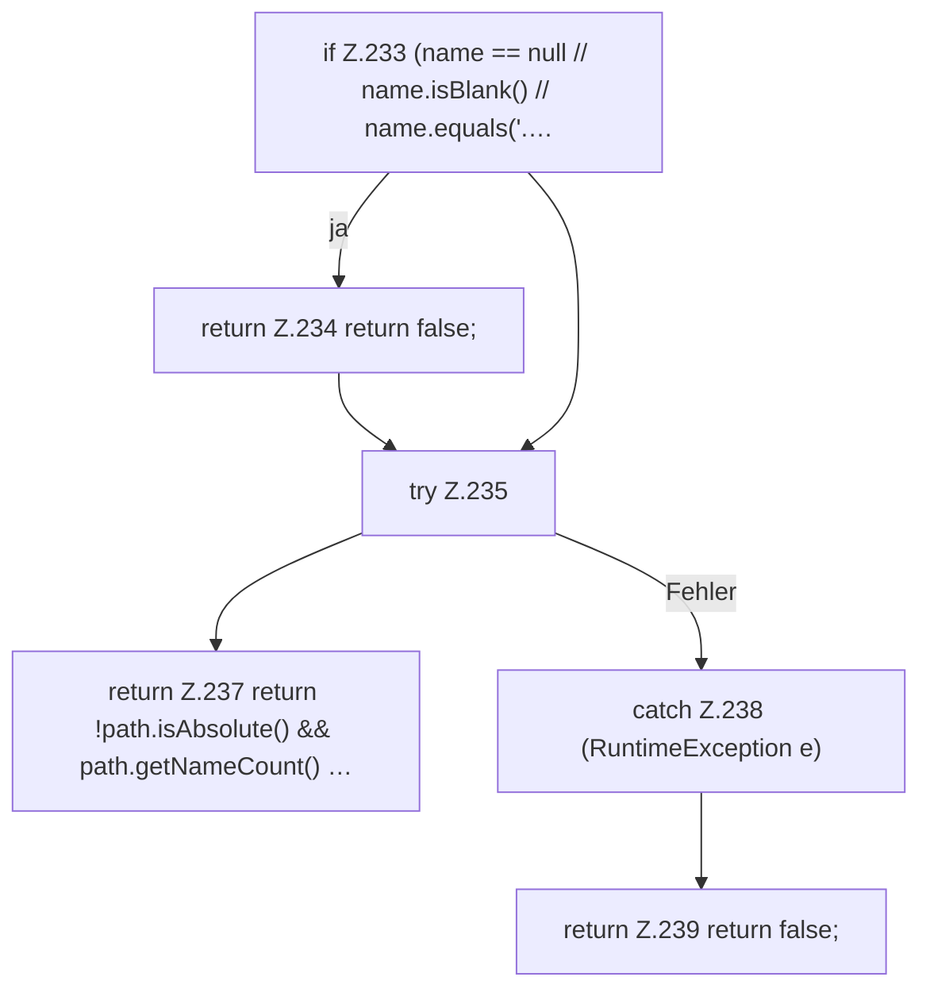

[[00 Start]] › [[Host-Betrieb]] › [[Host-Ersteinrichtung]] › [[HostFirstSetup]] › [[HostFirstSetup.Teil2]] › [[HostFirstSetup.safeWorldName]]

# HostFirstSetup.safeWorldName

`HostFirstSetup.safeWorldName(String name)` [src/main/java/de/aichele/childlauncher/HostFirstSetup.java:232–241](https://github.com/Sciddie/minecraft-serverhoster-plugin/blob/95b02b953b0b4c23673e900e021a7c3c844aa37d/src/main/java/de/aichele/childlauncher/HostFirstSetup.java#L232-L241)



```knoten
if Z.233 (name == null // name.isBlank() // name.equals('.…
  Zeile 233: prüft `(name == null // name.isBlank() // name.equals('.…`.
return Z.234 return false;
  Zeile 234: Rückgabe `return false;`.
try Z.235
  Zeile 235: Versuch. Der Fehlerpfad geht in catch.
return Z.237 return !path.isAbsolute() && path.getNameCount() …
  Zeile 237: Rückgabe `return !path.isAbsolute() && path.getNameCount() …`.
catch Z.238 (RuntimeException e)
  Zeile 238: fängt (RuntimeException e).
return Z.239 return false;
  Zeile 239: Rückgabe `return false;`.
```

- `safeWorldName` in `src/main/java/de/aichele/childlauncher/HostFirstSetup.java`
