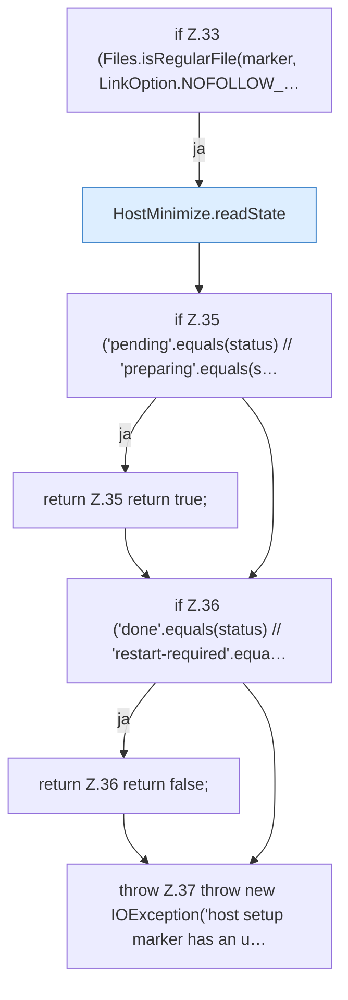

[[00 Start]] › [[Host-Betrieb]] › [[Host-Ersteinrichtung]] › [[HostFirstSetup]] › [[HostFirstSetup.Teil1]] › [[HostFirstSetup.shouldRun]] › [[HostFirstSetup.shouldRun.Z33]]

# HostFirstSetup.shouldRun.Z33



```knoten
if Z.33 (Files.isRegularFile(marker, LinkOption.NOFOLLOW_…
  Zeile 33: prüft `(Files.isRegularFile(marker, LinkOption.NOFOLLOW_…`.
HostMinimize.readState
  Liest `readState`.
if Z.35 ('pending'.equals(status) // 'preparing'.equals(s…
  Zeile 35: prüft `('pending'.equals(status) // 'preparing'.equals(s…`.
return Z.35 return true;
  Zeile 35: Rückgabe `return true;`.
if Z.36 ('done'.equals(status) // 'restart-required'.equa…
  Zeile 36: prüft `('done'.equals(status) // 'restart-required'.equa…`.
return Z.36 return false;
  Zeile 36: Rückgabe `return false;`.
throw Z.37 throw new IOException('host setup marker has an u…
  Zeile 37: Abbruch `throw new IOException('host setup marker has an u…`.
```

- Fortsetzung von `HostFirstSetup.shouldRun`, Quellreihenfolge.
