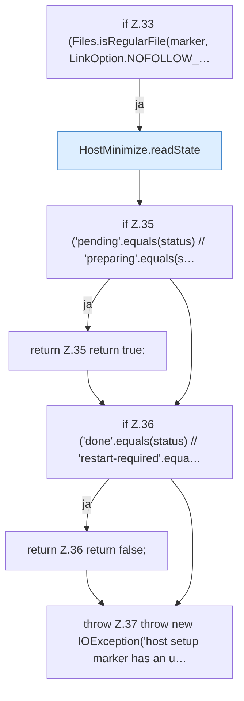

[[00 Start]] › [[Host-Betrieb]] › [[Host-Ersteinrichtung]] › [[HostFirstSetup]] › [[HostFirstSetup.Teil1]] › [[HostFirstSetup.shouldRun]] › [[HostFirstSetup.shouldRun.Z33]]

# HostFirstSetup.shouldRun.Z33

- Fortsetzung von `HostFirstSetup.shouldRun`, Quellreihenfolge.
