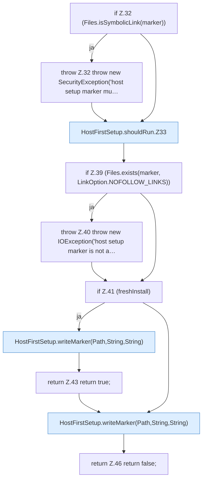

[[00 Start]] › [[Host-Betrieb]] › [[Host-Ersteinrichtung]] › [[HostFirstSetup]] › [[HostFirstSetup.Teil1]] › [[HostFirstSetup.shouldRun]]

# HostFirstSetup.shouldRun

`HostFirstSetup.shouldRun(Path marker, boolean freshInstall)` [src/main/java/de/aichele/childlauncher/HostFirstSetup.java:31–47](https://github.com/Sciddie/minecraft-serverhoster-plugin/blob/95b02b953b0b4c23673e900e021a7c3c844aa37d/src/main/java/de/aichele/childlauncher/HostFirstSetup.java#L31-L47)



```knoten
if Z.32 (Files.isSymbolicLink(marker))
  Zeile 32: prüft `(Files.isSymbolicLink(marker))`.
throw Z.32 throw new SecurityException('host setup marker mu…
  Zeile 32: Abbruch `throw new SecurityException('host setup marker mu…`.
HostFirstSetup.shouldRun.Z33
  Der Ablauf geht in [[Glossar#Zeile|Zeile]] 33 weiter. Eine Ebene tiefer steht er genauer. Fortsetzung des Ablaufs ab Zeile 33.
if Z.39 (Files.exists(marker, LinkOption.NOFOLLOW_LINKS))
  Zeile 39: prüft `(Files.exists(marker, LinkOption.NOFOLLOW_LINKS))`.
throw Z.40 throw new IOException('host setup marker is not a…
  Zeile 40: Abbruch `throw new IOException('host setup marker is not a…`.
if Z.41 (freshInstall)
  Zeile 41: prüft `(freshInstall)`.
HostFirstSetup.writeMarker(Path,String,String)
  Die [[Glossar#Ersteinrichtung|Ersteinrichtung]] schreibt die Merkdatei. Schreibt `writeMarker`. Ruft `writeMarker`.
return Z.43 return true;
  Zeile 43: Rückgabe `return true;`.
return Z.46 return false;
  Zeile 46: Rückgabe `return false;`.
```

> [!knoten]- Was die Blöcke tun
> - **if Z.32 (Files.isSymbolicLink(marker))**: Zeile 32: prüft `(Files.isSymbolicLink(marker))`.
> - **throw Z.32 throw new SecurityException('host setup marker mu…**: Zeile 32: Abbruch `throw new SecurityException('host setup marker mu…`.
> - **HostFirstSetup.shouldRun.Z33**: Der Ablauf geht in [[Glossar#Zeile|Zeile]] 33 weiter. Eine Ebene tiefer steht er genauer. Fortsetzung des Ablaufs ab Zeile 33.
> - **if Z.39 (Files.exists(marker, LinkOption.NOFOLLOW_LINKS))**: Zeile 39: prüft `(Files.exists(marker, LinkOption.NOFOLLOW_LINKS))`.
> - **throw Z.40 throw new IOException('host setup marker is not a…**: Zeile 40: Abbruch `throw new IOException('host setup marker is not a…`.
> - **if Z.41 (freshInstall)**: Zeile 41: prüft `(freshInstall)`.
> - **HostFirstSetup.writeMarker(Path,String,String)**: Die [[Glossar#Ersteinrichtung|Ersteinrichtung]] schreibt die Merkdatei. Schreibt `writeMarker`. Ruft `writeMarker`.
> - **return Z.43 return true;**: Zeile 43: Rückgabe `return true;`.
> - **return Z.46 return false;**: Zeile 46: Rückgabe `return false;`.

- Die [[Glossar#Ersteinrichtung|Ersteinrichtung]] führt aus das.
- `shouldRun` in `src/main/java/de/aichele/childlauncher/HostFirstSetup.java`
- Befund: Altlast, wahrscheinlich. HostFirstSetup.java:35 akzeptiert pending; Schreibstelle nur HostMinimizeTest.java:216
