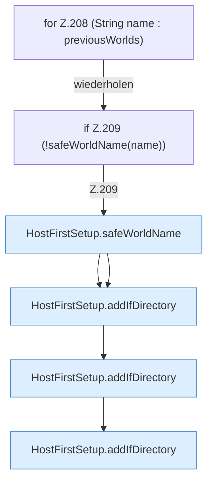

[[00 Start]] › [[Host-Betrieb]] › [[Host-Ersteinrichtung]] › [[HostFirstSetup]] › [[HostFirstSetup.Teil2]] › [[HostFirstSetup.worldDirectories]] › [[HostFirstSetup.worldDirectories.Z208]]

# HostFirstSetup.worldDirectories.Z208



```knoten
for Z.208 (String name : previousWorlds)
  Zeile 208: Schleife `(String name : previousWorlds)`.
if Z.209 (!safeWorldName(name))
  Zeile 209: prüft `(!safeWorldName(name))`.
HostFirstSetup.safeWorldName
  Die [[Glossar#Ersteinrichtung|Ersteinrichtung]] kümmert sich um die [[Glossar#Spielwelt|Spielwelt]] den Namen. Prüft die Pfadgrenze `safeWorldName`.
HostFirstSetup.addIfDirectory
  Die [[Glossar#Ersteinrichtung|Ersteinrichtung]] fügt hinzu hier einen Schritt. Eine Ebene tiefer steht er genauer. Fügt hinzu `addIfDirectory`. Ruft `safeWorldName`.
```

> [!knoten]- Was die Blöcke tun
> - **for Z.208 (String name : previousWorlds)**: Zeile 208: Schleife `(String name : previousWorlds)`.
> - **if Z.209 (!safeWorldName(name))**: Zeile 209: prüft `(!safeWorldName(name))`.
> - **HostFirstSetup.safeWorldName**: Die [[Glossar#Ersteinrichtung|Ersteinrichtung]] kümmert sich um die [[Glossar#Spielwelt|Spielwelt]] den Namen. Prüft die Pfadgrenze `safeWorldName`.
> - **HostFirstSetup.addIfDirectory**: Die [[Glossar#Ersteinrichtung|Ersteinrichtung]] fügt hinzu hier einen Schritt. Eine Ebene tiefer steht er genauer. Fügt hinzu `addIfDirectory`. Ruft `safeWorldName`.

- Der Ablauf geht in [[Glossar#Zeile|Zeile]] 208 weiter. Eine Ebene tiefer steht er genauer.
- Fortsetzung von `HostFirstSetup.worldDirectories`.
