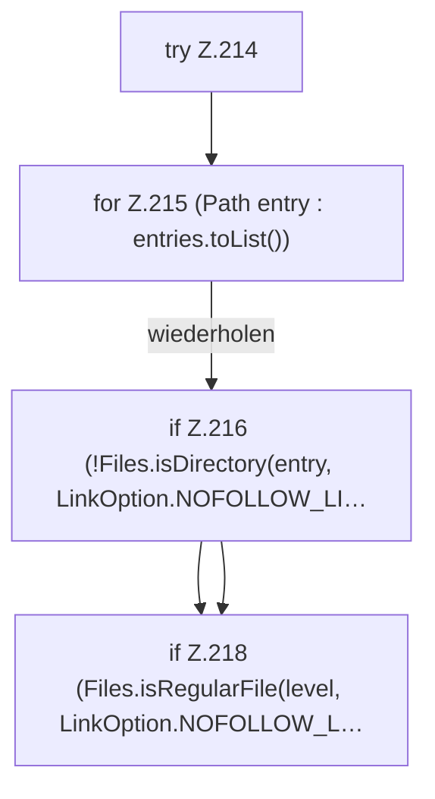

[[00 Start]] › [[Host-Betrieb]] › [[Host-Ersteinrichtung]] › [[HostFirstSetup]] › [[HostFirstSetup.Teil2]] › [[HostFirstSetup.worldDirectories]] › [[HostFirstSetup.worldDirectories.Z214]]

# HostFirstSetup.worldDirectories.Z214

- Fortsetzung von `HostFirstSetup.worldDirectories`, Quellreihenfolge.
