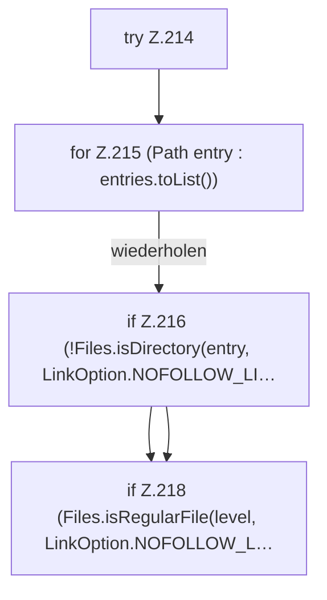

[[00 Start]] › [[Host-Betrieb]] › [[Host-Ersteinrichtung]] › [[HostFirstSetup]] › [[HostFirstSetup.Teil2]] › [[HostFirstSetup.worldDirectories]] › [[HostFirstSetup.worldDirectories.Z214]]

# HostFirstSetup.worldDirectories.Z214



```knoten
try Z.214
  Zeile 214: Versuch. Der Fehlerpfad geht in catch.
for Z.215 (Path entry : entries.toList())
  Zeile 215: Schleife `(Path entry : entries.toList())`.
if Z.216 (!Files.isDirectory(entry, LinkOption.NOFOLLOW_LI…
  Zeile 216: prüft `(!Files.isDirectory(entry, LinkOption.NOFOLLOW_LI…`.
if Z.218 (Files.isRegularFile(level, LinkOption.NOFOLLOW_L…
  Zeile 218: prüft `(Files.isRegularFile(level, LinkOption.NOFOLLOW_L…`.
```

> [!knoten]- Was die Blöcke tun
> - **try Z.214**: Zeile 214: Versuch. Der Fehlerpfad geht in catch.
> - **for Z.215 (Path entry : entries.toList())**: Zeile 215: Schleife `(Path entry : entries.toList())`.
> - **if Z.216 (!Files.isDirectory(entry, LinkOption.NOFOLLOW_LI…**: Zeile 216: prüft `(!Files.isDirectory(entry, LinkOption.NOFOLLOW_LI…`.
> - **if Z.218 (Files.isRegularFile(level, LinkOption.NOFOLLOW_L…**: Zeile 218: prüft `(Files.isRegularFile(level, LinkOption.NOFOLLOW_L…`.

- Der Ablauf geht in [[Glossar#Zeile|Zeile]] 214 weiter. Eine Ebene tiefer steht er genauer.
- Fortsetzung von `HostFirstSetup.worldDirectories`.
