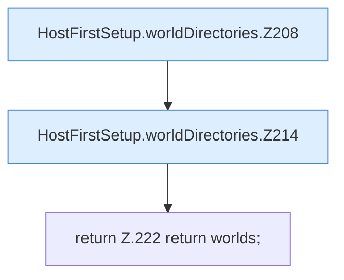

[[00 Start]] › [[Host-Betrieb]] › [[Host-Ersteinrichtung]] › [[HostFirstSetup]] › [[HostFirstSetup.Teil2]] › [[HostFirstSetup.worldDirectories]]

# HostFirstSetup.worldDirectories

`HostFirstSetup.worldDirectories(Path root, List<String> previousWorlds)` [src/main/java/de/aichele/childlauncher/HostFirstSetup.java:206–223](https://github.com/Sciddie/minecraft-serverhoster-plugin/blob/95b02b953b0b4c23673e900e021a7c3c844aa37d/src/main/java/de/aichele/childlauncher/HostFirstSetup.java#L206-L223)



```knoten
HostFirstSetup.worldDirectories.Z208
  Fortsetzung des Ablaufs ab Zeile 208.
HostFirstSetup.worldDirectories.Z214
  Fortsetzung des Ablaufs ab Zeile 214.
return Z.222 return worlds;
  Zeile 222: Rückgabe `return worlds;`.
```

- `worldDirectories` in `src/main/java/de/aichele/childlauncher/HostFirstSetup.java`
