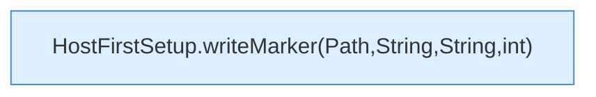

[[00 Start]] › [[Host-Betrieb]] › [[Host-Ersteinrichtung]] › [[HostFirstSetup]] › [[HostFirstSetup.Teil3]] › [[HostFirstSetup.writeMarker(Path,String,String)]]

# HostFirstSetup.writeMarker(Path,String,String)

`HostFirstSetup.writeMarker(Path marker, String status, String worldName)` [src/main/java/de/aichele/childlauncher/HostFirstSetup.java:325–327](https://github.com/Sciddie/minecraft-serverhoster-plugin/blob/95b02b953b0b4c23673e900e021a7c3c844aa37d/src/main/java/de/aichele/childlauncher/HostFirstSetup.java#L325-L327)



```knoten
HostFirstSetup.writeMarker(Path,String,String,int)
  Die [[Glossar#Ersteinrichtung|Ersteinrichtung]] schreibt die Merkdatei. Schreibt `writeMarker`. Ruft `writeMarker`.
```

> [!knoten]- Was die Blöcke tun
> - **HostFirstSetup.writeMarker(Path,String,String,int)**: Die [[Glossar#Ersteinrichtung|Ersteinrichtung]] schreibt die Merkdatei. Schreibt `writeMarker`. Ruft `writeMarker`.

- Die [[Glossar#Ersteinrichtung|Ersteinrichtung]] schreibt die Merkdatei.
- `writeMarker` in `src/main/java/de/aichele/childlauncher/HostFirstSetup.java`
